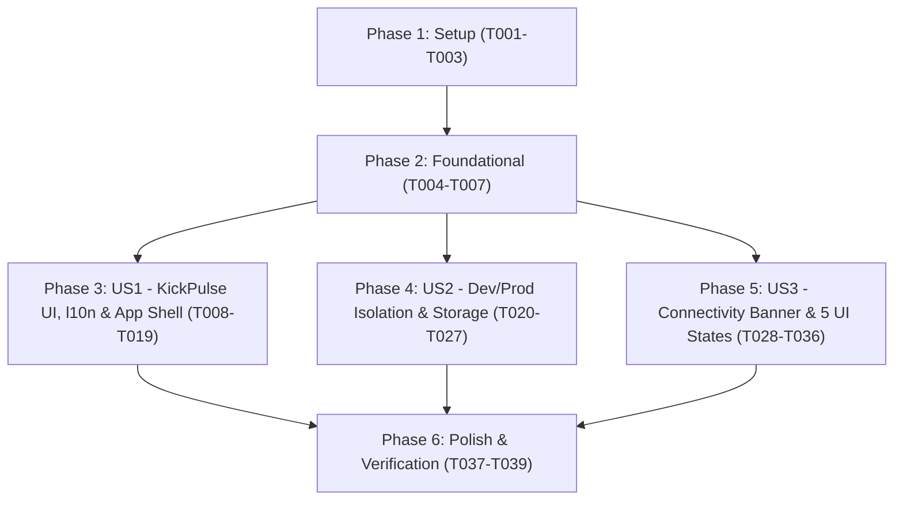

---

description: "Task list for HU 1.1 — Fundación de la Aplicación, Aislamiento de Entornos, Localización y Sistema de Diseño"
---

# Tasks: HU 1.1 — Fundación de la Aplicación, Aislamiento de Entornos, Localización y Sistema de Diseño

**Input**: Design documents from `/specs/001-app-foundation-design/`
**Prerequisites**: `plan.md` (required), `spec.md` (required for user stories), `research.md`, `data-model.md`, `contracts/ui-foundation-contract.md`, `quickstart.md`

**Tests**: Required by Constitution v2.0.0 Principle III (*Automated Tests as Quality Gate — NON-NEGOTIABLE*). Unit and widget tests are included per user story.

**Organization**: Tasks are grouped by user story (`US1`, `US2`, `US3`) to enable independent implementation, verification, and incremental delivery.

## Format: `[ID] [P?] [Story] Description`

- **[P]**: Can run in parallel (different files, no dependencies on incomplete tasks)
- **[Story]**: Which user story this task belongs to (`[US1]`, `[US2]`, `[US3]`)
- Exact file paths are included in every task description
- **Language Rule (Constitution Principle VI)**: All filenames, classes, methods, variables, and test descriptions in **English**; all visible UI copy in **Spanish** via `lib/l10n/app_es.arb`.

## Path Conventions

- **Flutter Mobile Project**: `lib/domain/`, `lib/application/`, `lib/infrastructure/`, `lib/presentation/`, `lib/env/`, `lib/l10n/`, and `test/` at repository root.

---

## Phase 1: Setup (Shared Infrastructure)

**Purpose**: Project initialization, dependency configuration, localization codegen setup, and Clean Architecture directory scaffolding.

- [X] T001 Configure required dependencies (`flutter_localizations`, `intl`, `flutter_riverpod`, `fluro`, `hive`, `hive_flutter`, `connectivity_plus`, and `mocktail` in dev_dependencies) and `flutter: generate: true` in `pubspec.yaml`
- [X] T002 [P] Create localization generator configuration (`arb-dir: lib/l10n`, `template-arb-file: app_es.arb`, `output-localization-file: app_localizations.dart`, `nullable-getter: false`) in `l10n.yaml`
- [X] T003 [P] Create Clean Architecture directory structure (`lib/domain/entities`, `lib/domain/failures`, `lib/domain/repositories`, `lib/application/use_cases`, `lib/application/controllers`, `lib/application/providers`, `lib/infrastructure/storage`, `lib/infrastructure/connectivity`, `lib/presentation/design_system/widgets`, `lib/presentation/navigation`, `lib/presentation/shell/widgets`, `lib/presentation/shell/tabs`, `lib/env`, `lib/l10n`, and `test/` subdirectories)

---

## Phase 2: Foundational (Blocking Prerequisites)

**Purpose**: Core domain contracts, Spanish localization dictionary (`es`), and base dependency injection providers that MUST be complete before any user story can be implemented.

**⚠️ CRITICAL**: No user story work can begin until this phase is complete.

- [X] T004 [P] Create `AppFailure` sealed failure hierarchy (`StorageInitializationFailure`, `EnvironmentValidationFailure`, `ConnectivityFailure`, `DataLoadFailure`) in `lib/domain/failures/app_failure.dart`
- [X] T005 [P] Create `AppShellSection` (`matchday`, `standings`, `venues`, `profile`) and `AppShellState` domain entities in `lib/domain/entities/app_shell_section.dart`
- [X] T006 [P] Create Spanish (`es`) localization ARB catalog with all App Shell tabs, connectivity banner messages, environment badge labels, and 5 UI state copies in `lib/l10n/app_es.arb` and generate `AppLocalizations` via `flutter gen-l10n`
- [X] T007 Create foundational Riverpod provider declarations (`environmentConfigProvider`, `localStorageRepositoryProvider`, `connectivityRepositoryProvider`) in `lib/application/providers/foundation_providers.dart`

**Checkpoint**: Foundation ready — user story implementation can now begin in parallel.

---

## Phase 3: User Story 1 - Experiencia Visual Deportiva y Localización en Español (Priority: P1) 🎯 MVP

**Goal**: Deliver the *KickPulse Mobile* dark-first athletic UI (`#080B11` canvas, `#0E1422` surface, `#22C55E` pitch accent, `Inter` typography with `tabular-nums`, `>= 44x44px` touch targets, single-flight tap guard), 100% Spanish (`es`) localization, portrait orientation lock, and the 4-tab `AppShellScreen` (*Jornada*, *Posiciones*, *Sedes*, *Perfil*).

**Independent Test**: Launch the app in simulator/device and run `flutter test test/presentation/` to verify that the App Shell renders in Spanish with *KickPulse Mobile* tokens, `tabular-nums` alignment on numeric scores/timers, `>= 44x44px` interactive targets, single-flight anti-double-tap protection, and bottom navigation across the 4 base sections without layout overflow at 130% text scale.

### Tests for User Story 1 ⚠️

> **NOTE: Write these tests FIRST, ensure they FAIL before implementation**

- [X] T008 [P] [US1] Write unit tests verifying *KickPulse Mobile* color tokens (`#080B11`, `#0E1422`, `#22C55E`, `#EF4444`, `#F59E0B`, `#38BDF8`), radii (`16`, `12`, `9999`), minimum touch target (`44.0`), and `FontFeature.tabularFigures()` in `test/presentation/design_system_tokens_test.dart`
- [X] T009 [P] [US1] Write widget tests verifying Spanish localization (`Jornada`, `Posiciones`, `Sedes`, `Perfil`), bottom navigation switching, `>= 44x44px` hit targets, single-flight button guard, and 130% text scaling resilience in `test/presentation/app_shell_widget_test.dart`

### Implementation for User Story 1

- [X] T010 [P] [US1] Implement `KickPulseColors` semantic dark-first palette (`canvasBackground`, `surfaceBase`, `surfaceElevated`, `glassOverlay`, `textPrimary`, `textSecondary`, `textMuted`, `accentPrimary`, `accentLive`, `accentWarning`, `accentElectric`, `borderSubtle`) in `lib/presentation/design_system/kick_pulse_colors.dart`
- [X] T011 [P] [US1] Implement `KickPulseTypography` scale (`displayScore`, `screenTitle`, `sectionHeader`, `cardTitle`, `bodyPrimary`, `captionMeta`, `microBadge`) with system font fallback and `FontFeature.tabularFigures()` in `lib/presentation/design_system/kick_pulse_typography.dart`
- [X] T012 [P] [US1] Implement `KickPulseRadiiSpacing` tokens (`cardRadius = 16`, `chipRadius = 12`, `badgeRadius = 9999`, `minTouchTarget = 44`, 4px/8px grid spacing) in `lib/presentation/design_system/kick_pulse_radii_spacing.dart`
- [X] T013 [US1] Build `KickPulseTheme.darkTheme` combining color, typography, and component themes in `lib/presentation/design_system/kick_pulse_theme.dart`
- [X] T014 [P] [US1] Create `KickPulseCard` (`16px` radius, `1px` `borderSubtle`) and `KickPulseBadge` (`9999px` pill radius, semantic colors) widgets in `lib/presentation/design_system/widgets/kick_pulse_card.dart` and `lib/presentation/design_system/widgets/kick_pulse_badge.dart`
- [X] T015 [P] [US1] Create `KickPulseButton` widget enforcing `ConstrainedBox(minWidth: 44, minHeight: 44)` and single-flight `Future<void> Function()?` execution lock in `lib/presentation/design_system/widgets/kick_pulse_button.dart`
- [X] T016 [US1] Implement `AppShellController` managing active `AppShellSection` selection and per-tab state map in `lib/application/controllers/app_shell_controller.dart`
- [X] T017 [P] [US1] Implement `AppRouter` using `Fluro` with `/`, `/matchday`, `/standings`, `/venues`, and `/profile` route handlers in `lib/presentation/navigation/app_router.dart`
- [X] T018 [P] [US1] Create the 4 localized shell tab views (`MatchdayTabView`, `StandingsTabView`, `VenuesTabView`, `ProfileTabView`) using `AppLocalizations` and *KickPulse Mobile* components in `lib/presentation/shell/tabs/matchday_tab_view.dart`, `lib/presentation/shell/tabs/standings_tab_view.dart`, `lib/presentation/shell/tabs/venues_tab_view.dart`, and `lib/presentation/shell/tabs/profile_tab_view.dart`
- [X] T019 [US1] Implement `AppShellScreen` with top environment/title bar, `IndexedStack` body for the 4 tabs, and localized `NavigationBar` in `lib/presentation/shell/app_shell_screen.dart`

**Checkpoint**: At this point, User Story 1 is fully functional and independently testable (`flutter test test/presentation/`).

---

## Phase 4: User Story 2 - Aislamiento Operativo de Entornos de Desarrollo y Producción (Priority: P1)

**Goal**: Guarantee 100% data and configuration isolation between `dev` (`lib/env/main.dev.dart`, prefix `vifutbol_dev`, visible `DEV` badge) and `prod` (`lib/env/main.prod.dart`, prefix `vifutbol_prod`, hidden badge), preventing cross-environment pollution and redacting sensitive tokens in logs/errors.

**Independent Test**: Run `flutter test test/domain/environment_config_test.dart test/infrastructure/hive_local_storage_repository_test.dart` to verify that writing records in `dev` never leaks into `prod`, invalid environment combinations fail fast, and corrupted local storage degrades gracefully to an in-memory store.

### Tests for User Story 2 ⚠️

> **NOTE: Write these tests FIRST, ensure they FAIL before implementation**

- [X] T020 [P] [US2] Write unit tests for `EnvironmentConfig` invariants (`development` vs `production` storage prefixes, `showEnvironmentBanner`, rejection of cross-environment namespace mixing, and credential redaction in `toSafeDiagnosticMap()`) in `test/domain/environment_config_test.dart`
- [X] T021 [P] [US2] Write unit tests for `HiveLocalStorageRepository` verifying zero data leakage between `vifutbol_dev` and `vifutbol_prod` namespaces and automatic in-memory fallback upon storage initialization failure in `test/infrastructure/hive_local_storage_repository_test.dart`

### Implementation for User Story 2

- [X] T022 [P] [US2] Create `AppEnvironment` enum (`development`, `production`), `LocalStorageStatus` entity in `lib/domain/entities/local_storage_status.dart`, and `EnvironmentConfig` entity with strict namespace validation and `toSafeDiagnosticMap()` redaction in `lib/domain/entities/app_environment.dart`
- [X] T023 [P] [US2] Define `LocalStorageRepository` interface (`initialize`, `readString`, `writeString`, `clearNamespace`, `isUsingFallbackMemory`) in `lib/domain/repositories/local_storage_repository.dart`
- [X] T024 [US2] Implement `HiveLocalStorageRepository` with isolated box prefixing (`${storagePrefix}_preferences`, `${storagePrefix}_cache`) and resilient in-memory fallback in `lib/infrastructure/storage/hive_local_storage_repository.dart`
- [X] T025 [US2] Implement `InitializeAppFoundationUseCase` orchestrating environment validation and isolated storage initialization in `lib/application/use_cases/initialize_app_foundation_use_case.dart`
- [X] T026 [US2] Create `App` root widget in `lib/presentation/app.dart` and `bootstrapApp(EnvironmentConfig config)` enforcing `SystemChrome.setPreferredOrientations([DeviceOrientation.portraitUp])`, initializing isolated storage, and mounting `ProviderScope` with `App` in `lib/app_bootstrap.dart`
- [X] T027 [P] [US2] Create isolated entrypoints `lib/env/main.dev.dart` (`AppEnvironment.development`, `vifutbol_dev`, `showEnvironmentBanner: true`), `lib/env/main.prod.dart` (`AppEnvironment.production`, `vifutbol_prod`, `showEnvironmentBanner: false`), and default `lib/main.dart` delegating to `dev`

**Checkpoint**: At this point, User Stories 1 AND 2 work independently and environment isolation is verified by automated tests.

---

## Phase 5: User Story 3 - Resiliencia en el Arranque, Conectividad y Estados Base de Interfaz (Priority: P2)

**Goal**: Provide reactive connectivity awareness (persistent offline banner when disconnected, 3-second green restoration banner when reconnected), standardized 5-state UI views (`Carga`, `Contenido`, `Vacío`, `Error`, `Éxito`) across all App Shell tabs, and lifecycle state preservation when backgrounding/resuming.

**Independent Test**: Run `flutter test test/application/` to verify the `ConnectivityBannerController` state transitions (including the 3-second `restored` auto-hide timer with fake async) and verify interactive state switching (`Carga`, `Contenido`, `Vacío`, `Error` with retry, `Éxito`) and lifecycle preservation across all 4 shell tabs.

### Tests for User Story 3 ⚠️

> **NOTE: Write these tests FIRST, ensure they FAIL before implementation**

- [X] T028 [P] [US3] Write unit tests for `ConnectivityBannerController` verifying transitions (`connected -> disconnected` shows persistent warning banner; `disconnected -> connected` shows `restored` banner for 3 seconds then hides) in `test/application/connectivity_banner_controller_test.dart`
- [X] T029 [P] [US3] Write unit and widget tests for `AppShellController` and `KickPulseStateView` verifying transitions across all 5 `UiViewState` variants (`UiLoadingState`, `UiContentState`, `UiEmptyState`, `UiErrorState` retry action, `UiSuccessState`) and lifecycle preservation in `test/application/app_shell_controller_test.dart`

### Implementation for User Story 3

- [X] T030 [P] [US3] Create `NetworkConnectionStatus` (`connected`, `disconnected`), `ConnectivityBannerVisibility` (`hidden`, `offline`, `restored`), and `ConnectivityBannerState` entities in `lib/domain/entities/connectivity_status.dart`
- [X] T031 [P] [US3] Create generic sealed `UiViewState<T>` (`UiLoadingState`, `UiContentState`, `UiEmptyState`, `UiErrorState`, `UiSuccessState`) in `lib/domain/entities/ui_view_state.dart`
- [X] T032 [P] [US3] Define `ConnectivityRepository` interface in `lib/domain/repositories/connectivity_repository.dart` and implement `PlatformConnectivityRepository` wrapping `connectivity_plus` in `lib/infrastructure/connectivity/platform_connectivity_repository.dart`
- [X] T033 [US3] Implement `WatchConnectivityUseCase` in `lib/application/use_cases/watch_connectivity_use_case.dart` and `ConnectivityBannerController` (with 3-second `Timer` for `restored -> hidden` transition) in `lib/application/controllers/connectivity_banner_controller.dart`
- [X] T034 [P] [US3] Create reactive `ConnectivityBanner` widget (`Modo sin conexión: mostrando datos guardados en el dispositivo` in `#F59E0B` and `Conexión restaurada` in `#22C55E`) in `lib/presentation/shell/widgets/connectivity_banner.dart`
- [X] T035 [P] [US3] Create `KickPulseStateView<T>` widget rendering the 5 canonical UI states (`Carga`, `Contenido`, `Vacío`, `Error` with `Reintentar` `KickPulseButton`, and `Éxito`) in `lib/presentation/design_system/widgets/kick_pulse_state_view.dart`
- [X] T036 [US3] Integrate `ConnectivityBanner`, interactive 5-state verification selector, and `WidgetsBindingObserver` lifecycle state preservation into `lib/presentation/shell/app_shell_screen.dart` and the 4 tab views in `lib/presentation/shell/tabs/`

**Checkpoint**: All 3 user stories (`US1`, `US2`, `US3`) are independently functional and verified by automated unit and widget tests.

---

## Phase 6: Polish & Cross-Cutting Concerns

**Purpose**: Final static analysis, test suite coverage verification, and quickstart validation across all stories.

- [X] T037 [P] Remove legacy template tests and update root smoke test to verify `bootstrapApp` and `AppShellScreen` in `test/widget_test.dart`
- [X] T038 Run `flutter analyze` and `dart format --output=none --set-exit-if-changed lib test` to ensure zero lint warnings and 100% English technical identifiers across `lib/` and `test/`
- [X] T039 Execute full automated test suite with coverage (`flutter test --coverage`) and validate all scenarios from `specs/001-app-foundation-design/quickstart.md`

---

## Dependencies & Execution Order

### Phase Dependencies

- **Setup (Phase 1: T001–T003)**: No dependencies — can start immediately.
- **Foundational (Phase 2: T004–T007)**: Depends on Phase 1 completion — BLOCKS all user stories.
- **User Story 1 (Phase 3: T008–T019, P1 🎯 MVP)**: Depends on Foundational (Phase 2).
- **User Story 2 (Phase 4: T020–T027, P1)**: Depends on Foundational (Phase 2); can run in parallel with US1 and links `bootstrapApp` to `AppShellScreen` in T026.
- **User Story 3 (Phase 5: T028–T036, P2)**: Depends on Foundational (Phase 2); integrates connectivity banner and 5-state views into `AppShellScreen` in T036.
- **Polish (Phase 6: T037–T039)**: Depends on completion of US1, US2, and US3.

### User Story Dependencies



### Within Each User Story

- Automated tests (`T008–T009`, `T020–T021`, `T028–T029`) MUST be written first and fail before implementation.
- Domain entities & repository interfaces before infrastructure implementations and use cases.
- Design system tokens before reusable components, and components before screens.

---

## Parallel Opportunities

### Parallel Example: User Story 1

```bash
# Run US1 token implementations in parallel:
Task T010: "Implement KickPulseColors in lib/presentation/design_system/tokens/kickpulse_colors.dart"
Task T011: "Implement KickPulseTypography in lib/presentation/design_system/tokens/kickpulse_typography.dart"
Task T012: "Implement KickPulseRadiiSpacing in lib/presentation/design_system/tokens/kickpulse_radii_spacing.dart"

# Run US1 base components in parallel:
Task T014: "Create KickPulseCard and KickPulseBadge in lib/presentation/design_system/components/"
Task T015: "Create KickPulseButton in lib/presentation/design_system/components/kickpulse_button.dart"
```

### Parallel Example: User Story 2

```bash
# Run US2 tests and domain entities in parallel:
Task T020: "Write unit tests for EnvironmentConfig in test/domain/environment_config_test.dart"
Task T021: "Write unit tests for HiveLocalStorageRepository in test/infrastructure/hive_local_storage_repository_test.dart"
Task T022: "Create AppEnvironment and EnvironmentConfig in lib/domain/entities/app_environment.dart"
Task T023: "Define LocalStorageRepository interface in lib/domain/repositories/local_storage_repository.dart"
```

### Parallel Example: User Story 3

```bash
# Run US3 domain models and components in parallel:
Task T030: "Create ConnectivityStatus and ConnectivityBannerState in lib/domain/entities/connectivity_status.dart"
Task T031: "Create sealed UiViewState<T> in lib/domain/entities/ui_view_state.dart"
Task T034: "Create ConnectivityBanner widget in lib/presentation/design_system/components/connectivity_banner.dart"
Task T035: "Create KickPulseStateView<T> widget in lib/presentation/design_system/components/kickpulse_state_view.dart"
```

---

## Implementation Strategy

### MVP First (User Story 1 + User Story 2 P1 Core)

1. Complete **Phase 1: Setup** (`T001–T003`) and **Phase 2: Foundational** (`T004–T007`).
2. Complete **Phase 3: User Story 1** (`T008–T019`) to establish the *KickPulse Mobile* design system, Spanish (`es`) localization, and 4-tab `AppShellScreen`.
3. Complete **Phase 4: User Story 2** (`T020–T027`) to lock in `dev`/`prod` entrypoint and storage isolation.
4. **STOP and VALIDATE**: Run unit and widget tests for US1 and US2 independently.

### Incremental Delivery

1. **Foundation Ready** (`T001–T007`): Dependencies, `l10n` generator, failure hierarchy, and providers ready.
2. **Increment 1 — Visual Identity & Localization (`US1`, `T008–T019`)**: Deliverable App Shell with *KickPulse Mobile* tokens and 100% Spanish UI.
3. **Increment 2 — Environment Isolation (`US2`, `T020–T027`)**: `main.dev.dart` and `main.prod.dart` running on isolated `Hive` boxes with fallback safety.
4. **Increment 3 — Field Resilience & UI States (`US3`, `T028–T036`)**: Reactive connectivity banner (3s restoration auto-hide) and 5 canonical UI states (`Carga`, `Contenido`, `Vacío`, `Error`, `Éxito`).
5. **Final Quality Gate (`T037–T039`)**: Zero analyzer warnings and 100% passing test suite.
