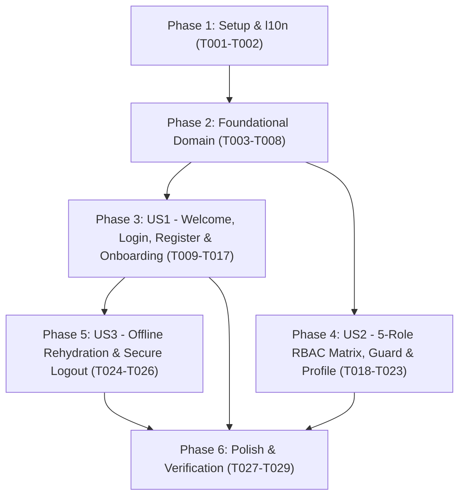

---

description: "Task list for HU 2.1 — Autenticación, Onboarding y Control de Acceso Basado en Roles (RBAC)"
---

# Tasks: HU 2.1 — Autenticación, Onboarding y Control de Acceso Basado en Roles (RBAC)

**Input**: Design documents from `/specs/002-auth-onboarding-rbac/`
**Prerequisites**: `plan.md` (required), `spec.md` (required for user stories), `research.md`, `data-model.md`, `contracts/auth-rbac-contract.md`, `quickstart.md`

**Tests**: Required by Constitution v2.0.0 Principle III (*Automated Tests as Quality Gate — NON-NEGOTIABLE*). Unit and widget tests are included per user story.

**Organization**: Tasks are grouped by user story (`US1`, `US2`, `US3`) to enable independent implementation, verification, and incremental delivery.

## Format: `[ID] [P?] [Story] Description`

- **[P]**: Can run in parallel (different files, no dependencies on incomplete tasks)
- **[Story]**: Which user story this task belongs to (`[US1]`, `[US2]`, `[US3]`)
- Exact file paths are included in every task description
- **Language Rule (Constitution Principle VI)**: All filenames, classes, methods, variables, and test descriptions in **English**; all visible UI copy in **Spanish** via `lib/l10n/app_es.arb`.

## Path Conventions

- **Flutter Mobile Project**: `lib/domain/`, `lib/application/`, `lib/infrastructure/`, `lib/presentation/`, `lib/l10n/`, and `test/` at repository root.

---

## Phase 1: Setup (Shared Infrastructure)

**Purpose**: Create feature directories and expand the Spanish localization catalog (`app_es.arb`) with all authentication, onboarding, role names, capabilities, and error messages.

- [X] T001 Create directory structure for authentication and RBAC modules (`lib/infrastructure/auth`, `lib/presentation/auth/widgets`)
- [X] T002 Expand Spanish (`es`) localization catalog with login/registration labels, validation messages (`>= 8` password chars, invalid email, `"Correo o contraseña incorrectos"`), 60-second lockout notice, 5 role names (`Organizador`, `Entrenador`, `Árbitro`, `Jugador`, `Aficionado`), role capability descriptions, and logout/discard confirmations in `lib/l10n/app_es.arb` and regenerate `AppLocalizations` via `flutter gen-l10n`

---

## Phase 2: Foundational (Blocking Prerequisites)

**Purpose**: Core domain entities, failure types, repository contracts, and base Riverpod providers that MUST be complete before any user story can be implemented.

**⚠️ CRITICAL**: No user story work can begin until this phase is complete.

- [X] T003 [P] Create `UserRole` enum (`organizer`, `coach`, `referee`, `player`, `fan`) with `requiresAuthorizationCodeInProd` (`true` for `organizer` and `referee`, `false` for `coach`, `player`, `fan`) in `lib/domain/entities/user_role.dart`
- [X] T004 [P] Extend `AppFailure` sealed hierarchy with `InvalidCredentialsFailure`, `AuthRateLimitFailure`, `OfflineAuthOperationFailure`, `UnauthorizedRoleFailure`, and `InvalidAuthorizationCodeFailure` in `lib/domain/failures/app_failure.dart`
- [X] T005 [P] Create `UserAccount` (`id` UUID, `fullName` `>= 2` chars, normalized lowercase `email`, `activeRole`, `authorizedRoles` always containing `activeRole` and `UserRole.fan`, `isGuestFan`, `onboardingCompleted`) in `lib/domain/entities/user_account.dart`
- [X] T006 [P] Create `AuthSession` (`sessionId` UUID, `user`, `sessionToken` redacted as `[REDACTED]` in `toString()`, `authenticatedAt`) in `lib/domain/entities/auth_session.dart`
- [X] T007 [P] Create `AuthStatus` enum (`initializing`, `unauthenticated`, `needsOnboarding`, `authenticated`) and immutable `AuthFlowState` (`status`, `session`, `isSubmitting`, `failedAttempts`, `lockedUntil`, `draftEmail`, `draftFullName`, `lastFailure`) in `lib/domain/entities/auth_flow_state.dart`
- [X] T008 Define `AuthRepository` contract (`restoreSession`, `signInWithEmail`, `registerAccount`, `continueAsGuestFan`, `completeRoleOnboarding`, `switchActiveRole`, `signOut`) in `lib/domain/repositories/auth_repository.dart`

**Checkpoint**: Foundation ready — user story implementation can now begin.

---

## Phase 3: User Story 1 - Registro, Inicio de Sesión y Onboarding de Rol Deportivo (Priority: P1) 🎯 MVP

**Goal**: Deliver the initial `WelcomeAuthScreen` entry gate (*Iniciar sesión*, *Crear cuenta*, *"Continuar como Aficionado"*), real-time Spanish validation, single-flight anti-double-submit protection, 60-second lockout after 5 consecutive failed attempts, `RoleOnboardingScreen` for initial role selection, and `AuthGate` routing into `AppShellScreen`.

**Independent Test**: Run `flutter test test/application/auth_controller_test.dart test/presentation/auth_flow_widget_test.dart` to verify registration, login, guest `Aficionado` entry, preservation of email on failed login, 60s lockout after 5 failed attempts, role onboarding completion, and `>= 44x44px` touch targets at 130% text scale.

### Tests for User Story 1 ⚠️

> **NOTE: Write these tests FIRST, ensure they FAIL before implementation**

- [X] T009 [P] [US1] Write unit tests for `AuthController` covering registration (`unauthenticated -> needsOnboarding`), role onboarding completion (`needsOnboarding -> authenticated`), login (`unauthenticated -> authenticated`), guest `Aficionado` access, preservation of `draftEmail` on invalid credentials, and 60-second `lockedUntil` lockout on the 5th consecutive failed login in `test/application/auth_controller_test.dart`
- [X] T010 [P] [US1] Write widget tests for `WelcomeAuthScreen`, `RoleOnboardingScreen`, and `AuthGate` verifying 100% Spanish localization, keyboard focus actions (`TextInputAction.next` / `TextInputAction.done`), single-flight submit lock, unsaved changes confirmation on back navigation, and 130% text scaling without overflow in `test/presentation/auth_flow_widget_test.dart`

### Implementation for User Story 1

- [X] T011 [US1] Implement `LocalAuthRepository` supporting account registration, email/password verification, guest `Aficionado` session creation, and role onboarding persistence on top of `LocalStorageRepository` and `ConnectivityRepository` in `lib/infrastructure/auth/local_auth_repository.dart`
- [X] T012 [P] [US1] Implement `AuthenticateUserUseCase` (email format check, password `>= 8` chars, online connectivity check for new login/registration, and guest `Aficionado` login) in `lib/application/use_cases/authenticate_user_use_case.dart`
- [X] T013 [US1] Implement `AuthController` managing `AuthFlowState`, single-flight `isSubmitting` lock, `failedAttempts` counter with 60-second `lockedUntil` timer on 5th failure, and non-sensitive form draft preservation (`draftEmail`, `draftFullName`) in `lib/application/controllers/auth_controller.dart`
- [X] T014 [US1] Create Riverpod providers (`authRepositoryProvider`, `authControllerProvider`, `activeUserRoleProvider`, `activeRoleCapabilitiesProvider`) in `lib/application/providers/auth_providers.dart`
- [X] T015 [P] [US1] Create `WelcomeAuthScreen` with *Iniciar sesión* / *Crear cuenta* tabs, keyboard focus chaining (`Siguiente` → `Enviar`), inline Spanish validation, error banner, and *"Continuar como Aficionado"* CTA in `lib/presentation/auth/welcome_auth_screen.dart`
- [X] T016 [P] [US1] Create `RoleOnboardingScreen` with interactive cards for the 5 `UserRole` options, optional authorization code input for `organizer`/`referee` in `prod`, and `PopScope` confirmation when discarding unsaved selection in `lib/presentation/auth/role_onboarding_screen.dart`
- [X] T017 [US1] Create reactive `AuthGate` widget routing between `WelcomeAuthScreen`, `RoleOnboardingScreen`, and `AppShellScreen` in `lib/presentation/auth/auth_gate.dart` and update `lib/presentation/app.dart` and `lib/presentation/navigation/app_router.dart` (`/auth`, `/onboarding`)

**Checkpoint**: At this point, User Story 1 is fully functional and testable independently.

---

## Phase 4: User Story 2 - Control de Acceso Basado en los Cinco Roles del Campeonato (RBAC) (Priority: P1)

**Goal**: Enforce strict role-based access control across all 5 roles (`Organizador`, `Entrenador`, `Árbitro`, `Jugador`, `Aficionado`) via `RolePermissionMatrix` and `KickPulseRoleGuard`, and enrich `ProfileTabView` with the active role badge, authorized role switcher, and interactive permissions panel.

**Independent Test**: Run `flutter test test/domain/role_permission_matrix_test.dart` and `flutter test test/presentation/auth_flow_widget_test.dart` to verify that every `RoleCapability` is granted only to its authorized roles, `organizer`/`referee` require an authorization code in `prod` while all 5 roles are freely switchable in `dev`, and `KickPulseRoleGuard` blocks unauthorized actions in Spanish.

### Tests for User Story 2 ⚠️

> **NOTE: Write these tests FIRST, ensure they FAIL before implementation**

- [X] T018 [P] [US2] Write exhaustive unit tests for `RolePermissionMatrix` verifying all 10 `RoleCapability` permissions across the 5 `UserRole` values and authorization code validation in `AppEnvironment.production` vs `AppEnvironment.development` in `test/domain/role_permission_matrix_test.dart`
- [X] T019 [P] [US2] Add widget tests in `test/presentation/auth_flow_widget_test.dart` verifying `KickPulseRoleGuard` blocks unauthorized roles with a Spanish restriction notice and `ProfileTabView` switches active roles and updates visible capabilities

### Implementation for User Story 2

- [X] T020 [P] [US2] Implement `RoleCapability` enum (`manageTournaments`, `manageVenues`, `approveRegistrations`, `assignReferees`, `manageTeamRoster`, `manageLineups`, `recordMatchEvents`, `closeMatchReport`, `viewPersonalStats`, `viewPublicContent`) and deterministic `RolePermissionMatrix` in `lib/domain/entities/role_permission_matrix.dart`
- [X] T021 [P] [US2] Implement `CheckRolePermissionUseCase` (capability verification and environment-aware role authorization check) in `lib/application/use_cases/check_role_permission_use_case.dart`
- [X] T022 [P] [US2] Create `KickPulseRoleGuard` widget enforcing `RoleCapability` access with localized Spanish restricted-state fallback in `lib/presentation/auth/widgets/kick_pulse_role_guard.dart`
- [X] T023 [US2] Update `ProfileTabView` to display authenticated user identity (or guest `Aficionado` banner), semantic `KickPulseBadge` for active `UserRole`, authorized role switcher, and interactive RBAC capability matrix verification in `lib/presentation/shell/tabs/profile_tab_view.dart`

**Checkpoint**: At this point, User Stories 1 AND 2 work independently and RBAC enforcement is verified across all 5 roles.

---

## Phase 5: User Story 3 - Rehidratación de Sesión Offline y Cierre de Sesión Seguro (Priority: P2)

**Goal**: Guarantee automatic offline session and role rehydration (`< 2s`) on app launch, preserve non-sensitive form inputs across mobile lifecycle background/foreground transitions, and execute secure logout (`< 1s`) wiping stored session tokens and sensitive cache.

**Independent Test**: Run `flutter test test/infrastructure/local_auth_repository_test.dart` to verify offline session rehydration without network, environment namespace isolation (`vifutbol_dev` vs `vifutbol_prod`), token redaction in `toString()`, and complete credential wipe upon `signOut()`.

### Tests for User Story 3 ⚠️

> **NOTE: Write these tests FIRST, ensure they FAIL before implementation**

- [X] T024 [P] [US3] Write unit tests for `LocalAuthRepository` verifying offline session rehydration when `NetworkConnectionStatus.disconnected`, rejection of new login/registration when offline, `sessionToken` redaction (`[REDACTED]`), and complete session removal on `signOut()` in `test/infrastructure/local_auth_repository_test.dart`

### Implementation for User Story 3

- [X] T025 [P] [US3] Implement `ManageSessionUseCase` orchestrating startup session rehydration, active role persistence, and secure logout cleanup in `lib/application/use_cases/manage_session_use_case.dart`
- [X] T026 [US3] Integrate `WidgetsBindingObserver` lifecycle draft preservation into `WelcomeAuthScreen` and connect `ManageSessionUseCase` logout/rehydration actions in `lib/application/controllers/auth_controller.dart` and `lib/presentation/shell/tabs/profile_tab_view.dart`

**Checkpoint**: All 3 user stories (`US1`, `US2`, `US3`) are independently functional and verified by automated unit and widget tests.

---

## Phase 6: Polish & Cross-Cutting Concerns

**Purpose**: Update existing smoke/shell tests for compatibility with `AuthGate`, run static analysis, format code, and verify full test suite coverage.

- [X] T027 [P] Update `test/widget_test.dart` and `test/presentation/app_shell_widget_test.dart` overrides if needed to verify seamless integration between `AuthGate` and `AppShellScreen`
- [X] T028 Run `flutter analyze` and `dart format --output=none --set-exit-if-changed lib test` to ensure zero warnings and 100% English technical identifiers
- [X] T029 Execute full automated test suite with coverage (`flutter test --coverage`) and validate all scenarios in `specs/002-auth-onboarding-rbac/quickstart.md`

---

## Dependencies & Execution Order

### Phase Dependencies

- **Setup (Phase 1: T001–T002)**: No dependencies — can start immediately.
- **Foundational (Phase 2: T003–T008)**: Depends on Phase 1 completion — BLOCKS all user stories.
- **User Story 1 (Phase 3: T009–T017, P1 🎯 MVP)**: Depends on Foundational (Phase 2).
- **User Story 2 (Phase 4: T018–T023, P1)**: Depends on Foundational (Phase 2); integrates with `AuthController` and `ProfileTabView` in T023.
- **User Story 3 (Phase 5: T024–T026, P2)**: Depends on Foundational (Phase 2) and `LocalAuthRepository` / `AuthController` from US1.
- **Polish (Phase 6: T027–T029)**: Depends on completion of US1, US2, and US3.

### User Story Dependencies



### Within Each User Story

- Automated tests (`T009–T010`, `T018–T019`, `T024`) MUST be written first and fail before implementation.
- Domain entities & use cases before controllers and UI screens.

---

## Parallel Opportunities

### Parallel Example: Foundational Phase

```bash
Task T003: "Create UserRole enum in lib/domain/entities/user_role.dart"
Task T004: "Extend AppFailure hierarchy in lib/domain/failures/app_failure.dart"
Task T005: "Create UserAccount entity in lib/domain/entities/user_account.dart"
Task T006: "Create AuthSession entity in lib/domain/entities/auth_session.dart"
Task T007: "Create AuthFlowState entity in lib/domain/entities/auth_flow_state.dart"
```

### Parallel Example: User Story 1

```bash
Task T015: "Create WelcomeAuthScreen in lib/presentation/auth/welcome_auth_screen.dart"
Task T016: "Create RoleOnboardingScreen in lib/presentation/auth/role_onboarding_screen.dart"
```

### Parallel Example: User Story 2

```bash
Task T018: "Write unit tests for RolePermissionMatrix in test/domain/role_permission_matrix_test.dart"
Task T020: "Implement RoleCapability and RolePermissionMatrix in lib/domain/entities/role_permission_matrix.dart"
Task T021: "Implement CheckRolePermissionUseCase in lib/application/use_cases/check_role_permission_use_case.dart"
Task T022: "Create KickPulseRoleGuard in lib/presentation/auth/widgets/kick_pulse_role_guard.dart"
```

---

## Implementation Strategy

### MVP First (User Story 1 + User Story 2 P1 Core)

1. Complete **Phase 1: Setup** (`T001–T002`) and **Phase 2: Foundational** (`T003–T008`).
2. Complete **Phase 3: User Story 1** (`T009–T017`) to enable login, registration, guest `Aficionado` access, and role onboarding.
3. Complete **Phase 4: User Story 2** (`T018–T023`) to enforce the 5-role permission matrix and role switching in `ProfileTabView`.
4. **STOP and VALIDATE**: Run unit and widget tests for US1 and US2.

### Incremental Delivery

1. **Foundation Ready** (`T001–T008`): Spanish `l10n` strings and core auth domain entities ready.
2. **Increment 1 — Auth & Onboarding Flow (`US1`, `T009–T017`)**: `WelcomeAuthScreen`, `RoleOnboardingScreen`, and `AuthGate` operational.
3. **Increment 2 — 5-Role RBAC & Profile (`US2`, `T018–T023`)**: `RolePermissionMatrix`, `KickPulseRoleGuard`, and `ProfileTabView` role management active.
4. **Increment 3 — Offline Rehydration & Secure Logout (`US3`, `T024–T026`)**: Full offline session recovery and instant credential cleanup.
5. **Final Quality Gate (`T027–T029`)**: Zero analyzer warnings and 100% passing test suite.
