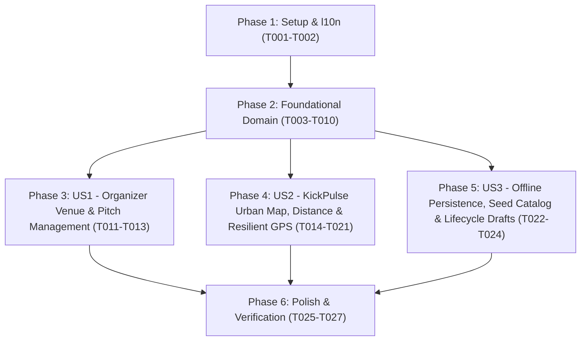

---

description: "Task list for HU 3.1 — Gestión de Sedes, Canchas Urbanas y Geolocalización Deportiva"
---

# Tasks: HU 3.1 — Gestión de Sedes, Canchas Urbanas y Geolocalización Deportiva

**Input**: Design documents from `/specs/003-venues-pitches-geolocation/`
**Prerequisites**: `plan.md` (required), `spec.md` (required for user stories), `research.md`, `data-model.md`, `contracts/venues-geolocation-contract.md`, `quickstart.md`

**Tests**: Required by Constitution v2.0.0 Principle III (*Automated Tests as Quality Gate — NON-NEGOTIABLE*). Unit and widget tests are included per user story.

**Organization**: Tasks are grouped by user story (`US1`, `US2`, `US3`) to enable independent implementation, verification, and incremental delivery.

## Format: `[ID] [P?] [Story] Description`

- **[P]**: Can run in parallel (different files, no dependencies on incomplete tasks)
- **[Story]**: Which user story this task belongs to (`[US1]`, `[US2]`, `[US3]`)
- Exact file paths are included in every task description
- **Language Rule (Constitution Principle VI)**: All filenames, classes, methods, variables, and test descriptions in **English**; all visible UI copy in **Spanish** via `lib/l10n/app_es.arb`.

## Path Conventions

- **Flutter Mobile Project**: `lib/domain/`, `lib/application/`, `lib/infrastructure/`, `lib/presentation/`, `lib/l10n/`, and `test/` at repository root.

---

## Phase 1: Setup (Shared Infrastructure)

**Purpose**: Create feature directories and expand the Spanish localization catalog (`app_es.arb`) with all venue, pitch, surface, format, operational status, validation, and GPS permission strings.

- [X] T001 Create directory structure for venues and geolocation modules (`lib/infrastructure/location`, `lib/infrastructure/venues`, `lib/presentation/venues/widgets`)
- [X] T002 Expand Spanish (`es`) localization catalog with venue and pitch labels, surface types (`Césped Sintético`, `Césped Natural`, `Tierra / Arena`, `Cemento / Futsal`), pitch formats (`Fútbol 5`, `Fútbol 7`, `Fútbol 8`, `Fútbol 11`), operational status labels (`Activa`, `En mantenimiento`), validation messages (`>= 3` venue name chars, `>= 5` address chars, latitude in `[-90.0, 90.0]`, longitude in `[-180.0, 180.0]`, `>= 1` active pitch), GPS permission fallback banner (`"Ubicación desactivada: mostrando sedes por referencia urbana"`), empty state (`"Aún no hay sedes registradas"`), and discard confirmation (`"¿Descartar cambios de la sede?"`) in `lib/l10n/app_es.arb` and regenerate `AppLocalizations` via `flutter gen-l10n`

---

## Phase 2: Foundational (Blocking Prerequisites)

**Purpose**: Core domain entities, value objects, enums, failure types, and repository contracts that MUST be complete before any user story can be implemented.

**⚠️ CRITICAL**: No user story work can begin until this phase is complete.

- [X] T003 [P] Create `GeoCoordinate` value object (`latitude: double` required in range `[-90.0, 90.0]` not `NaN`/infinite, `longitude: double` required in range `[-180.0, 180.0]` not `NaN`/infinite, `isValidCoordinate(double lat, double lng)`, `distanceInKilometersTo(GeoCoordinate other)` using Haversine formula with `R = 6371.0 km`, and `defaultCityCenter = GeoCoordinate(latitude: 4.6097, longitude: -74.0817)`) in `lib/domain/entities/geo_coordinate.dart`
- [X] T004 [P] Create domain enums `PitchSurfaceType` (`syntheticGrass`, `naturalGrass`, `dirtOrSand`, `hardCourt`), `PitchFormat` (`football5`, `football7`, `football8`, `football11`), and `VenueOperationalStatus` (`active`, `maintenance`) in `lib/domain/entities/venue_enums.dart`
- [X] T005 [P] Create `VenuePitch` entity (`id: String` required `UUID`, `name: String` required `>= 2` chars, `surfaceType: PitchSurfaceType` required, `format: PitchFormat` required, `capacity: int` required `>= 0`, `hasLighting: bool` required, `status: VenueOperationalStatus` required) with JSON serialization in `lib/domain/entities/venue_pitch.dart`
- [X] T006 [P] Create `SportsVenue` entity (`id: String` required `UUID`, `name: String` required `>= 3` chars, `address: String` required `>= 5` chars, `urbanReference: String` required, `coordinate: GeoCoordinate` required, `pitches: List<VenuePitch>` required non-empty `>= 1` pitch, `status: VenueOperationalStatus` required, `updatedAt: DateTime` required, plus computed helpers `activePitchesCount`, `isEligibleForFixtures`, `hasNightLighting`) with JSON serialization in `lib/domain/entities/sports_venue.dart`
- [X] T007 [P] Create `LocationPermissionStatus` enum (`notRequested`, `granted`, `denied`, `permanentlyDenied`, `serviceDisabled`) and `LocationPermissionState` (`status: LocationPermissionStatus`, `userCoordinate: GeoCoordinate?` memory-only with `toString()` redacting `userCoordinate` as `[REDACTED_USER_LOCATION]` per `FR-009`) in `lib/domain/entities/location_permission_state.dart`
- [X] T008 [P] Create immutable `VenuesCatalogState` (`viewState: UiViewState`, `venues: List<SportsVenue>`, `selectedVenueId: String?`, `searchQuery: String`, `surfaceFilter: PitchSurfaceType?`, `onlyWithLighting: bool`, `sortByProximity: bool`, `locationState: LocationPermissionState`, `isSubmitting: bool`, `draftVenueName: String`, `draftAddress: String`, `draftUrbanReference: String`, `lastFailure: AppFailure?`) in `lib/domain/entities/venues_catalog_state.dart`
- [X] T009 [P] Extend `AppFailure` sealed hierarchy with `InvalidVenueDataFailure` and `LocationPermissionFailure` in `lib/domain/failures/app_failure.dart`
- [X] T010 [P] Define `VenuesRepository` contract (`loadVenues`, `saveVenue`, `updateVenueStatus`, `updatePitchStatus`, `restoreSeedCatalogIfEmpty`) in `lib/domain/repositories/venues_repository.dart` and `LocationPermissionRepository` contract (`getCurrentState`, `requestPermissionAndLocation`, `simulatePermissionStatusForDev`) in `lib/domain/repositories/location_permission_repository.dart`

**Checkpoint**: Foundation ready — user story implementation can now begin.

---

## Phase 3: User Story 1 - Creación, Edición y Gestión de Sedes y Canchas por el Organizador (Priority: P1) 🎯 MVP

**Goal**: Enable the `Organizador` (`RoleCapability.manageVenues`) to create, edit, and logically toggle the operational status (`active` / `maintenance`) of sports venues and their internal pitches (`VenuePitch`), validating coordinates (`[-90, 90]`, `[-180, 180]`), required fields, and single-flight submission while blocking write access for `Entrenador`, `Árbitro`, `Jugador`, and `Aficionado`.

**Independent Test**: Run `flutter test test/domain/sports_venue_geolocation_test.dart` and `flutter test test/presentation/venues_geolocation_widget_test.dart` to verify coordinate and venue validation, Haversine distance calculation, logical deactivation (`active <-> maintenance`) without physical deletion, RBAC restriction for non-organizer roles, and single-flight form submission.

### Tests for User Story 1 ⚠️

> **NOTE: Write these tests FIRST, ensure they FAIL before implementation**

- [X] T011 [P] [US1] Write unit tests for `GeoCoordinate`, `VenuePitch`, `SportsVenue`, and `ManageVenuesUseCase` verifying coordinate range constraints (`[-90.0, 90.0]` and `[-180.0, 180.0]`), Haversine distance calculation (`R = 6371.0 km`), venue validation (`name >= 3`, `address >= 5`, `pitches >= 1`), RBAC enforcement (`RoleCapability.manageVenues`), and logical status transitions (`active <-> maintenance`) in `test/domain/sports_venue_geolocation_test.dart`

### Implementation for User Story 1

- [X] T012 [P] [US1] Implement `ManageVenuesUseCase` enforcing `RoleCapability.manageVenues` for `UserRole.organizer`, validating `SportsVenue` (`name >= 3` chars, `address >= 5` chars, valid `GeoCoordinate`, `>= 1` active `VenuePitch`) and executing logical status updates (`active` / `maintenance`) without physical deletion in `lib/application/use_cases/manage_venues_use_case.dart`
- [X] T013 [US1] Implement `VenueFormScreen` protected by `KickPulseRoleGuard(requiredCapability: RoleCapability.manageVenues)` with interactive coordinate selection on `KickPulseUrbanMapCanvas` or numeric inputs, dynamic internal pitch list builder (`name >= 2`, `surfaceType`, `format`, `capacity >= 0`, `hasLighting`, `status`), single-flight `isSubmitting` lock, Spanish inline validation, and `PopScope` discard confirmation (`"¿Descartar cambios de la sede?"`) in `lib/presentation/venues/venue_form_screen.dart` and register route `/venues/form` in `lib/presentation/navigation/app_router.dart`

**Checkpoint**: At this point, User Story 1 is fully functional and testable independently.

---

## Phase 4: User Story 2 - Consulta Geolocalizada de Sedes, Cálculo de Distancia y Manejo Resiliente de Permisos Móviles (Priority: P1)

**Goal**: Provide all 5 roles with the interactive *KickPulse Urban Map* (`KickPulseUrbanMapCanvas`), venue detail sheet (`VenueDetailSheet`) with internal pitches breakdown, just-in-time GPS permission request with Haversine distance in `km` (`tabular-nums`), non-blocking fallback when location permission is denied or revoked, and a live GPS permission state simulator in `dev`.

**Independent Test**: Run `flutter test test/application/venues_controller_test.dart test/presentation/venues_geolocation_widget_test.dart` to verify map rendering, just-in-time permission transitions (`granted` showing distance in `km` vs `denied`/`permanentlyDenied` showing the non-intrusive Spanish fallback banner without blocking navigation), `dev` simulator switching, and 130% text scaling.

### Tests for User Story 2 ⚠️

> **NOTE: Write these tests FIRST, ensure they FAIL before implementation**

- [X] T014 [P] [US2] Write unit tests for `VenuesController` and `QueryVenuesGeolocationUseCase` covering just-in-time location permission requests (`notRequested -> granted / denied / permanentlyDenied`), Haversine proximity sorting, dev permission simulator (`Concedido`, `Denegado`, `Revocado`), search/surface/lighting filters, and `[REDACTED_USER_LOCATION]` privacy invariant in `test/application/venues_controller_test.dart`
- [X] T015 [P] [US2] Write widget tests for `VenuesTabView`, `KickPulseUrbanMapCanvas`, `VenueDetailSheet`, and `VenueFormScreen` verifying map marker rendering, just-in-time GPS permission states (granted distance in `km` with `tabular-nums` vs denied/revoked non-blocking Spanish fallback banner), RBAC visibility (`Organizador` vs `Aficionado`/`Jugador`), and 130% text scaling without overflow in `test/presentation/venues_geolocation_widget_test.dart`

### Implementation for User Story 2

- [X] T016 [P] [US2] Implement `DeviceLocationPermissionRepository` supporting just-in-time permission request, default urban reference fallback, in-memory-only user coordinate (`FR-009`), and `AppEnvironment.development` permission state simulator (`granted`, `denied`, `permanentlyDenied`) in `lib/infrastructure/location/device_location_permission_repository.dart`
- [X] T017 [P] [US2] Implement `QueryVenuesGeolocationUseCase` for filtering venues by `searchQuery`, `surfaceFilter`, and `onlyWithLighting`, computing Haversine distance in kilometers (`distanceInKilometersTo`), and sorting by proximity when `LocationPermissionStatus.granted` in `lib/application/use_cases/query_venues_geolocation_use_case.dart`
- [X] T018 [US2] Implement `VenuesController` (`StateNotifier<VenuesCatalogState>`) and Riverpod providers (`venuesRepositoryProvider`, `locationPermissionRepositoryProvider`, `venuesControllerProvider`) in `lib/application/controllers/venues_controller.dart` and `lib/application/providers/venues_providers.dart`
- [X] T019 [P] [US2] Implement `KickPulseUrbanMapCanvas` (`CustomPainter` urban tactical grid styled per `DESIGN.md` with `#080B11` canvas, `#0E1422` surface, `#22C55E` active venue markers, `#F59E0B` maintenance markers, `#38BDF8` user relative position marker, and tap-to-pick coordinate callback for `Organizador`) in `lib/presentation/venues/widgets/kick_pulse_urban_map_canvas.dart`
- [X] T020 [P] [US2] Implement `VenueDetailSheet` displaying full venue details (`name`, `address`, `urbanReference`, `coordinate`, `status` badge, copyable directions summary, and internal `VenuePitch` cards with surface, format, `tabular-nums` capacity, lighting badge, and `Organizador` edit/maintenance controls) in `lib/presentation/venues/venue_detail_sheet.dart`
- [X] T021 [US2] Update `VenuesTabView` with search bar, surface/lighting filter chips, just-in-time proximity toggle, non-intrusive Spanish location fallback banner, `dev` GPS permission simulator bar, `KickPulseUrbanMapCanvas`, 5 standardized UI states (`loading`, `content`, `empty`, `error`, `success`), and venue cards with `tabular-nums` distance in `lib/presentation/shell/tabs/venues_tab_view.dart`

**Checkpoint**: At this point, User Stories 1 AND 2 work independently and all geolocation/permission states are verified.

---

## Phase 5: User Story 3 - Disponibilidad Offline del Directorio de Sedes y Conservación de Estado en Campo (Priority: P2)

**Goal**: Guarantee instant offline availability (`< 2s`) of the venues catalog and internal pitches isolated by environment (`vifutbol_dev` / `vifutbol_prod`), preload 3 realistic urban seed venues in `dev`, and preserve form drafts across mobile background/foreground transitions.

**Independent Test**: Run `flutter test test/infrastructure/local_venues_repository_test.dart` to verify environment-isolated storage under key `venues_catalog`, automatic preload of 3 seed venues with multiple pitches in `dev`, offline loading in `< 2s`, and logical status persistence.

### Tests for User Story 3 ⚠️

> **NOTE: Write these tests FIRST, ensure they FAIL before implementation**

- [X] T022 [P] [US3] Write unit tests for `LocalVenuesRepository` verifying environment-isolated persistence (`venues_catalog` in `vifutbol_dev` vs `vifutbol_prod`), automatic preload of 3 urban seed venues with multiple pitches in `AppEnvironment.development`, instant offline reading (`< 2s`), and logical status persistence (`active` / `maintenance`) in `test/infrastructure/local_venues_repository_test.dart`

### Implementation for User Story 3

- [X] T023 [US3] Implement `LocalVenuesRepository` on top of `LocalStorageRepository` under key `venues_catalog` with automatic seed catalog of 3 realistic urban venues in `AppEnvironment.development` and logical status updates in `lib/infrastructure/venues/local_venues_repository.dart`
- [X] T024 [US3] Integrate `WidgetsBindingObserver` lifecycle draft preservation (`draftVenueName`, `draftAddress`, `draftUrbanReference`, and temporary pitches list) across background/foreground transitions in `lib/application/controllers/venues_controller.dart` and `lib/presentation/venues/venue_form_screen.dart`

**Checkpoint**: All 3 user stories (`US1`, `US2`, `US3`) are independently functional and verified by automated unit and widget tests.

---

## Phase 6: Polish & Cross-Cutting Concerns

**Purpose**: Ensure existing shell/smoke tests remain compatible with `VenuesTabView`, verify zero static analysis warnings, canonical formatting, and 100% passing test suite with coverage.

- [X] T025 [P] Update existing shell/smoke widget tests (`test/widget_test.dart` and `test/presentation/app_shell_widget_test.dart`) if needed to ensure seamless compatibility with the upgraded `VenuesTabView`
- [X] T026 Run `flutter analyze` and `dart format --output=none --set-exit-if-changed lib test` to ensure zero warnings and 100% English technical identifiers
- [X] T027 Execute full automated test suite with coverage (`flutter test --coverage`) and validate all scenarios in `specs/003-venues-pitches-geolocation/quickstart.md`

---

## Dependencies & Execution Order

### Phase Dependencies

- **Setup (Phase 1: T001–T002)**: No dependencies — can start immediately.
- **Foundational (Phase 2: T003–T010)**: Depends on Phase 1 completion — BLOCKS all user stories.
- **User Story 1 (Phase 3: T011–T013, P1 🎯 MVP)**: Depends on Foundational (Phase 2).
- **User Story 2 (Phase 4: T014–T021, P1)**: Depends on Foundational (Phase 2); integrates with `VenueFormScreen` and `ManageVenuesUseCase` from US1.
- **User Story 3 (Phase 5: T022–T024, P2)**: Depends on Foundational (Phase 2) and connects to `VenuesController` and `VenueFormScreen`.
- **Polish (Phase 6: T025–T027)**: Depends on completion of US1, US2, and US3.

### User Story Dependencies



### Within Each User Story

- Automated tests (`T011`, `T014–T015`, `T022`) MUST be written first and fail before implementation.
- Domain entities & use cases before controllers and UI screens.

---

## Parallel Opportunities

### Parallel Example: Foundational Phase

```bash
Task T003: "Create GeoCoordinate value object in lib/domain/entities/geo_coordinate.dart"
Task T004: "Create domain enums in lib/domain/entities/venue_enums.dart"
Task T005: "Create VenuePitch entity in lib/domain/entities/venue_pitch.dart"
Task T006: "Create SportsVenue entity in lib/domain/entities/sports_venue.dart"
Task T007: "Create LocationPermissionState in lib/domain/entities/location_permission_state.dart"
Task T008: "Create VenuesCatalogState in lib/domain/entities/venues_catalog_state.dart"
```

### Parallel Example: User Story 2

```bash
Task T016: "Implement DeviceLocationPermissionRepository in lib/infrastructure/location/device_location_permission_repository.dart"
Task T017: "Implement QueryVenuesGeolocationUseCase in lib/application/use_cases/query_venues_geolocation_use_case.dart"
Task T019: "Implement KickPulseUrbanMapCanvas in lib/presentation/venues/widgets/kick_pulse_urban_map_canvas.dart"
Task T020: "Implement VenueDetailSheet in lib/presentation/venues/venue_detail_sheet.dart"
```

---

## Implementation Strategy

### MVP First (User Story 1 + User Story 2 Core)

1. Complete **Phase 1: Setup** (`T001–T002`) and **Phase 2: Foundational** (`T003–T010`).
2. Complete **Phase 3: User Story 1** (`T011–T013`) to enable `Organizador` creation, editing, and logical status management of venues and internal pitches.
3. Complete **Phase 4: User Story 2** (`T014–T021`) to deliver the interactive *KickPulse Urban Map*, Haversine distance calculation, and resilient GPS permission handling across all 5 roles.
4. **STOP and VALIDATE**: Run unit and widget tests for US1 and US2.

### Incremental Delivery

1. **Foundation Ready** (`T001–T010`): Spanish `l10n` strings and pure domain entities (`GeoCoordinate`, `SportsVenue`, `VenuePitch`, `LocationPermissionState`) ready.
2. **Increment 1 — Organizer Venue & Pitch Administration (`US1`, `T011–T013`)**: `ManageVenuesUseCase` and `VenueFormScreen` operational with RBAC guard.
3. **Increment 2 — Geolocation, Map & Resilient Permissions (`US2`, `T014–T021`)**: `KickPulseUrbanMapCanvas`, `VenueDetailSheet`, and `VenuesTabView` with just-in-time GPS and `dev` simulator active.
4. **Increment 3 — Offline Storage, Seed Catalog & Draft Recovery (`US3`, `T022–T024`)**: `LocalVenuesRepository` with 3 seed venues in `dev` and background draft preservation.
5. **Final Quality Gate (`T025–T027`)**: Zero analyzer warnings and 100% passing test suite.
