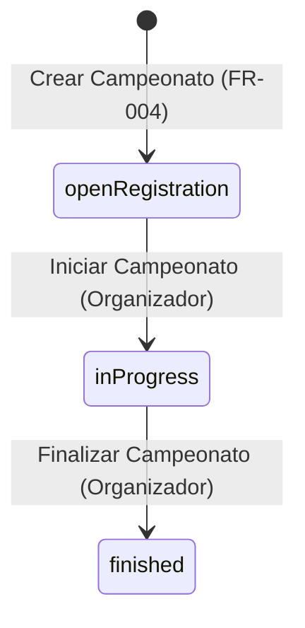

# Data Model: Creación de Campeonatos (Ligas y Copas Eliminatorias) y Reglas Personalizadas (HU 4.1)

**Feature**: `004-tournaments-custom-rules`  
**Date**: 2026-04-17

## 1. Domain Enumerations (`lib/domain/entities/tournament_enums.dart`)

### `TournamentFormat`
- `league`: Liga todos contra todos (1 o 2 vueltas).
- `knockoutCup`: Copa de eliminación directa por llaves.
- `mixedGroupsAndKnockout`: Fase de grupos seguida de llaves de eliminación directa.

### `TournamentStatus`
- `openRegistration`: `"Inscripciones Abiertas"` (estado inicial obligatorio al crear).
- `inProgress`: `"En Curso"` (activa la protección de inmutabilidad auditada sobre formato y puntuación).
- `finished`: `"Finalizado"` (bloquea mutaciones sobre formato y reglas).

### `TiebreakerCriterion`
- `goalDifference`: Diferencia de Gol (`DG`).
- `goalsFor`: Goles a Favor (`GF`).
- `headToHead`: Duelo Directo (`DD`).
- `fairPlay`: Juego Limpio / Menor puntaje de tarjetas (`FP`).

### `KnockoutRound`
- `roundOf16`: Octavos de Final (`16` equipos / `8` llaves).
- `quarterFinals`: Cuartos de Final (`8` equipos / `4` llaves).
- `semiFinals`: Semifinal (`4` equipos / `2` llaves).
- `finalMatch`: Final (`2` equipos / `1` llave).

## 2. Domain Value Objects & Entities

### `KnockoutStageConfig` (`lib/domain/entities/tournament_rules_config.dart`)
| Field | Type | Constraints / Defaults |
|-------|------|------------------------|
| `startingRound` | `KnockoutRound` | Default: `KnockoutRound.quarterFinals` |
| `twoLeggedTies` | `bool` | Default: `false` (partido único) |
| `directPenaltyShootoutOnDraw` | `bool` | Default: `true` (desempate directo por penales al finalizar tiempo reglamentario) |

- **Helper getter**: `List<KnockoutRound> get activeRoundsSequence` — devuelve la secuencia ordenada de rondas desde `startingRound` hasta `KnockoutRound.finalMatch` (ej. `[roundOf16, quarterFinals, semiFinals, finalMatch]`).

### `GroupStageConfig` (`lib/domain/entities/tournament_rules_config.dart`)
| Field | Type | Constraints / Defaults |
|-------|------|------------------------|
| `groupCount` | `int` | Rango válido: `2..8` (Default: `4`) |
| `advancingPerGroup` | `int` | Rango válido: `1..4` (Default: `2`), independiente del cupo de la llave eliminatoria |

### `TournamentRulesConfig` (`lib/domain/entities/tournament_rules_config.dart`)
| Field | Type | Constraints / Defaults |
|-------|------|------------------------|
| `pointsForWin` | `int` | Default: `3`. Invariante: `pointsForWin > pointsForDraw` |
| `pointsForDraw` | `int` | Default: `1`. Invariante: `pointsForDraw >= pointsForLoss` |
| `pointsForLoss` | `int` | Default: `0`. Invariante: `pointsForLoss >= 0` |
| `tiebreakerOrder` | `List<TiebreakerCriterion>` | Default: `[goalDifference, goalsFor, headToHead, fairPlay]`. Sin duplicados y no vacío. |
| `yellowCardSuspensionLimit` | `int` | Default: `3`. Rango válido: `2..10` |
| `minPlayersPerTeam` | `int` | Default: `7`. Rango válido: `5 <= minPlayersPerTeam <= maxPlayersPerTeam` |
| `maxPlayersPerTeam` | `int` | Default: `18`. Rango válido: `minPlayersPerTeam <= maxPlayersPerTeam <= 35` |
| `halfDurationMinutes` | `int` | Default: `45`. Rango válido: `10..60` |
| `leagueRounds` | `int` | Default: `1`. Valores permitidos: `1` o `2` |
| `knockoutConfig` | `KnockoutStageConfig` | Requerido y activo en `knockoutCup` y `mixedGroupsAndKnockout` |
| `groupStageConfig` | `GroupStageConfig` | Requerido y activo en `mixedGroupsAndKnockout` |

### `RuleAuditEntry` (`lib/domain/entities/rule_audit_entry.dart`)
| Field | Type | Constraints |
|-------|------|-------------|
| `recordedAt` | `DateTime` | Timestamp UTC/local del cambio confirmado |
| `summary` | `String` | Descripción legible de la transición (`formato` y/o `puntos V/E/D` anteriores → nuevos) |
| `reason` | `String` | Motivo administrativo obligatorio no vacío ingresado por el `Organizador` |
| `recalculationConfirmed` | `bool` | Siempre `true` cuando el `Organizador` autoriza el recálculo auditado |

### `ChampionshipTournament` (`lib/domain/entities/championship_tournament.dart`)
| Field | Type | Constraints |
|-------|------|-------------|
| `id` | `String` | Identificador único inmutable |
| `name` | `String` | No vacío, `>= 3` caracteres |
| `category` | `String` | No vacío (ej. `"Libre Masculino"`, `"Sub-20 Femenino"`) |
| `startDate` | `DateTime` | Fecha de inicio del campeonato |
| `endDate` | `DateTime` | Fecha de finalización (`!endDate.isBefore(startDate)`) |
| `format` | `TournamentFormat` | `league`, `knockoutCup` o `mixedGroupsAndKnockout` |
| `status` | `TournamentStatus` | Inicialmente `openRegistration` |
| `rules` | `TournamentRulesConfig` | Reglas personalizadas como fuente de verdad |
| `auditTrail` | `List<RuleAuditEntry>` | Historial inmutable de cambios críticos auditados |
| `updatedAt` | `DateTime` | Última actualización |

### `TournamentDraft` (`lib/domain/entities/tournament_draft.dart`)
| Field | Type | Constraints |
|-------|------|-------------|
| `name` | `String` | Texto parcial o completo |
| `category` | `String` | Texto parcial o completo |
| `startDate` | `DateTime` | Fecha seleccionada |
| `endDate` | `DateTime` | Fecha seleccionada |
| `format` | `TournamentFormat` | Formato en edición |
| `rules` | `TournamentRulesConfig` | Reglas en edición |
| `savedAt` | `DateTime` | Fecha/hora del último autoguardado local |

### `TournamentsCatalogState` (`lib/domain/entities/tournaments_catalog_state.dart`)
| Field | Type | Description |
|-------|------|-------------|
| `tournaments` | `List<ChampionshipTournament>` | Lista de campeonatos ordenados por fecha de actualización/inicio |
| `selectedTournamentId` | `String?` | Campeonato actualmente activo en la vista de `Posiciones` |
| `selectedFormatFilter` | `TournamentFormat?` | Filtro opcional por formato (`null` = todos) |
| `hasSavedDraft` | `bool` | Indica si existe un borrador local pendiente de recuperar |

## 3. State Machine Rules (`ChampionshipTournament`)

- En `openRegistration`: el `Organizador` puede editar libremente nombre, categoría, fechas, formato y todas las reglas personalizadas sin requerir motivo de auditoría.
- En `inProgress`: si cambia `format`, `rules.pointsForWin`, `rules.pointsForDraw` o `rules.pointsForLoss`, el dominio exige `confirmCriticalRuleOverride == true` y `auditReason.trim().isNotEmpty`, anexando un `RuleAuditEntry`.
- En `finished`: el campeonato es de solo lectura histórica; cualquier intento de edición devuelve `TournamentValidationFailure`.
