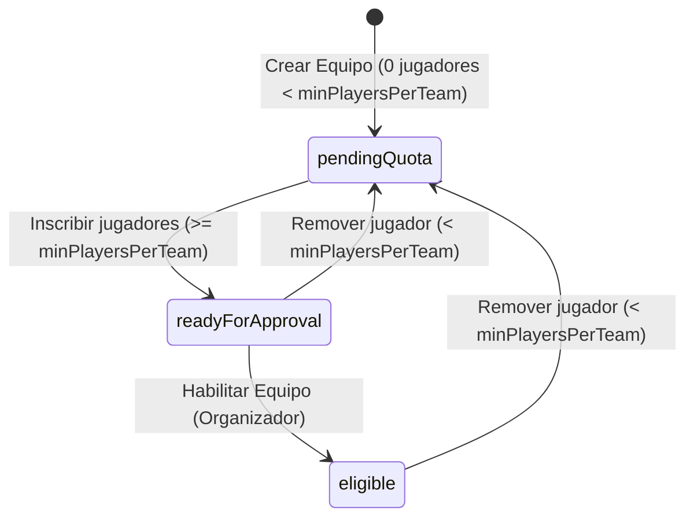

# Data Model: Registro Oficial de Equipos, Inscripción de Jugadores y Validación de Elegibilidad (HU 5.1)

**Feature**: `005-teams-players-eligibility`  
**Date**: 2026-04-17

## 1. Domain Enumerations (`lib/domain/entities/team_enums.dart`)

### `TeamEligibilityStatus`
- `pendingQuota`: `"Pendiente de Cupo"` (`players.length < minPlayersPerTeam`).
- `readyForApproval`: `"Listo para Habilitar"` (`players.length >= minPlayersPerTeam`, pendiente de confirmación del `Organizador`).
- `eligible`: `"Habilitado"` (aprobado oficialmente por el `Organizador`; sus jugadores están habilitados para ser convocados).

### `PlayerPosition`
- `goalkeeper`: `"Portero"` (`POR`)
- `defender`: `"Defensa"` (`DEF`)
- `midfielder`: `"Mediocampista"` (`MED`)
- `forward`: `"Delantero"` (`DEL`)

### `TeamCrestShape`
- `shield`: Escudo clásico
- `circle`: Emblema circular
- `diamond`: Rombo deportivo
- `hexagon`: Hexágono moderno

## 2. Domain Entities & Value Objects

### `RegisteredPlayer` (`lib/domain/entities/registered_player.dart`)
| Field | Type | Constraints |
|-------|------|-------------|
| `id` | `String` | Identificador único inmutable del registro de jugador |
| `fullName` | `String` | No vacío, `>= 3` caracteres |
| `documentId` | `String` | Documento de identidad numérico/alfanumérico normalizado (`>= 5` caracteres, único dentro del campeonato) |
| `shirtNumber` | `int` | Dorsal entero en rango `1..99`, único dentro del mismo equipo |
| `position` | `PlayerPosition` | `goalkeeper`, `defender`, `midfielder` o `forward` |
| `isEligible` | `bool` | `true` cuando el equipo está en `TeamEligibilityStatus.eligible` |

- **Helper getter**: `String get normalizedDocumentId => documentId.trim().toUpperCase()`

### `TournamentTeam` (`lib/domain/entities/tournament_team.dart`)
| Field | Type | Constraints |
|-------|------|-------------|
| `id` | `String` | Identificador único inmutable del equipo |
| `tournamentId` | `String` | Referencia obligatoria al `ChampionshipTournament.id` |
| `name` | `String` | No vacío, `>= 3` caracteres, único por `tournamentId` (comparación normalizada) |
| `shortCode` | `String` | Sigla/monograma en mayúsculas de `2..4` caracteres |
| `crestShape` | `TeamCrestShape` | Default: `TeamCrestShape.shield` |
| `primaryColorHex` | `int` | Valor ARGB entero del color primario (ej. `0xFF00E676`) |
| `secondaryColorHex` | `int` | Valor ARGB entero del color secundario (ej. `0xFF0A0E17`) |
| `eligibilityStatus` | `TeamEligibilityStatus` | Estado actual (`pendingQuota`, `readyForApproval`, `eligible`) |
| `players` | `List<RegisteredPlayer>` | Nómina de jugadores ordenada por `shirtNumber` ascendente |
| `updatedAt` | `DateTime` | Fecha/hora de última actualización |

- **Helper getters**:
  - `String get normalizedName => name.trim().toLowerCase()`
  - `bool meetsMinimumQuota(int minPlayers) => players.length >= minPlayers`
  - `bool hasAvailableSlot(int maxPlayers) => players.length < maxPlayers`

### `TeamsCatalogState` (`lib/domain/entities/teams_catalog_state.dart`)
| Field | Type | Description |
|-------|------|-------------|
| `teams` | `List<TournamentTeam>` | Todos los equipos persistidos en el catálogo |
| `selectedTeamId` | `String?` | Equipo actualmente seleccionado en la vista de detalle de plantilla |
| `isSaving` | `bool` | Bandera `single-flight` para prevenir envíos duplicados |
| `lastFailure` | `AppFailure?` | Último error de validación o permisos |

- **Helper method**: `List<TournamentTeam> teamsForTournament(String tournamentId)`

## 3. Eligibility State Transitions (`TournamentTeam`)

