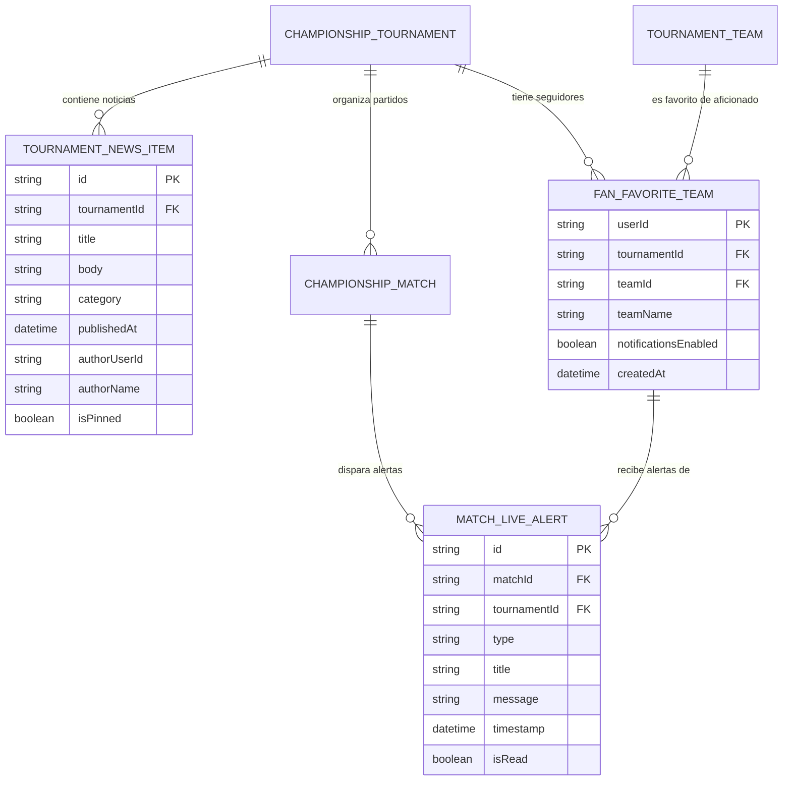

# Data Model: Feed de Noticias, Marcadores en Tiempo Real y Alertas para Aficionados (HU 9.1)

**Feature Branch**: `011-fan-feed-live-alerts`  
**Date**: 2026-11-05  
**Spec Reference**: [`specs/011-fan-feed-live-alerts/spec.md`](file:///Volumes/DATA/Development/FlutterProjects/vifutbol/specs/011-fan-feed-live-alerts/spec.md)

---

## 1. Entidades del Dominio

### 1.1 `TournamentNewsItem`
Representa una publicación oficial emitida dentro del contexto de un torneo por el `Organizador`.

```dart
class TournamentNewsItem {
  final String id;
  final String tournamentId;
  final String title;
  final String body;
  final TournamentNewsCategory category;
  final DateTime publishedAt;
  final String authorUserId;
  final String authorName;
  final bool isPinned;

  const TournamentNewsItem({
    required this.id,
    required this.tournamentId,
    required this.title,
    required this.body,
    required this.category,
    required this.publishedAt,
    required this.authorUserId,
    required this.authorName,
    this.isPinned = false,
  });
}
```

#### Reglas de Validación e Invariantes:
- `id`: No vacío, inmutable.
- `tournamentId`: No vacío, debe referenciar un torneo válido.
- `title`: Longitud mínima 3 caracteres, máxima 120 caracteres. No puede contener solo espacios.
- `body`: Longitud mínima 5 caracteres, máxima 3000 caracteres.
- `authorUserId` y `authorName`: No vacíos; representan al organizador responsable.

---

### 1.2 `TournamentNewsCategory`
Enumeración de clasificación temática para comunicados oficiales:

```dart
enum TournamentNewsCategory {
  general,
  disciplinary,
  rescheduling;

  String get storageKey => name;

  static TournamentNewsCategory fromString(String value) {
    return TournamentNewsCategory.values.firstWhere(
      (e) => e.name.toLowerCase() == value.trim().toLowerCase(),
      orElse: () => TournamentNewsCategory.general,
    );
  }
}
```

---

### 1.3 `FanFavoriteTeam`
Preferencia de suscripción y seguimiento de un equipo por parte de un aficionado.

```dart
class FanFavoriteTeam {
  final String userId;
  final String tournamentId;
  final String teamId;
  final String teamName;
  final bool notificationsEnabled;
  final DateTime createdAt;

  const FanFavoriteTeam({
    required this.userId,
    required this.tournamentId,
    required this.teamId,
    required this.teamName,
    this.notificationsEnabled = true,
    required this.createdAt,
  });
}
```

#### Reglas de Validación e Invariantes:
- Clave primaria compuesta o identidad: `(userId, tournamentId, teamId)`.
- `notificationsEnabled`: Booleano que activa o silencia de forma global todas las alertas del equipo (previas de 30 min, inicio, goles y pitazo final).

---

### 1.4 `MatchLiveAlert`
Notificación o registro de alerta generado para un aficionado respecto a un partido o noticia.

```dart
class MatchLiveAlert {
  final String id;
  final String matchId;
  final String tournamentId;
  final MatchAlertType type;
  final String title;
  final String message;
  final DateTime timestamp;
  final bool isRead;

  const MatchLiveAlert({
    required this.id,
    required this.matchId,
    required this.tournamentId,
    required this.type,
    required this.title,
    required this.message,
    required this.timestamp,
    this.isRead = false,
  });

  MatchLiveAlert copyWith({
    bool? isRead,
  }) {
    return MatchLiveAlert(
      id: id,
      matchId: matchId,
      tournamentId: tournamentId,
      type: type,
      title: title,
      message: message,
      timestamp: timestamp,
      isRead: isRead ?? this.isRead,
    );
  }
}
```

---

### 1.5 `MatchAlertType`
Tipos de alertas generadas en el ciclo de vida del campeonato:

```dart
enum MatchAlertType {
  matchUpcoming,
  matchStarted,
  goalScored,
  matchEnded,
  newsPublished;

  String get storageKey => name;

  static MatchAlertType fromString(String value) {
    return MatchAlertType.values.firstWhere(
      (e) => e.name.toLowerCase() == value.trim().toLowerCase(),
      orElse: () => MatchAlertType.matchUpcoming,
    );
  }
}
```

---

## 2. Diagrama de Relaciones de Entidades



---

## 3. Esquemas de Persistencia Local (JSON en `LocalStorageRepository`)

- **Noticias del torneo**: Clave `'vifutbol.tournament_news.v1'`
- **Equipos favoritos**: Clave `'vifutbol.fan_favorites.v1'`
- **Bandeja de alertas**: Clave `'vifutbol.match_alerts.v1'`
