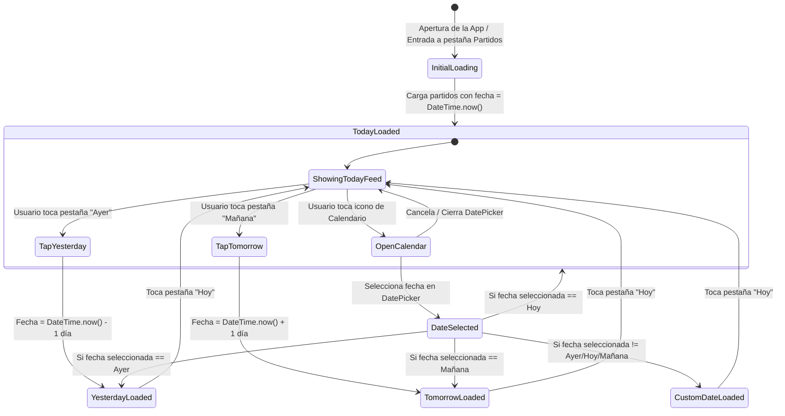

# Data Model: Feed Diario de Partidos y Navegación Temporal

**Feature**: `015-matches-daily-feed`  
**Date**: 2026-11-06  
**Status**: Completed

Este documento describe las entidades, estructuras de estado y modelos de presentación necesarios para soportar el feed diario de partidos agrupados por torneo, el selector de calendario y las pestañas temporales rápidas (Ayer, Hoy, Mañana).

---

## 1. Entities & Value Objects

### 1.1. `MatchesDailyTab` (Enum)
Representa la selección en la barra de navegación rápida de fechas.

```dart
enum MatchesDailyTab {
  yesterday,
  today,
  tomorrow,
  customDate,
}
```

### 1.2. `DailyMatchesDateState` (Value Object / State)
Modela la fecha seleccionada en la vista y su correspondencia con las pestañas rápidas.

- **Atributos**:
  - `selectedDate` (`DateTime`): Fecha activa normalizada a medianoche (`year`, `month`, `day`).
  - `activeTab` (`MatchesDailyTab`): Pestaña actualmente activa (`yesterday`, `today`, `tomorrow`, o `customDate`).
  - `isCustomDate` (`bool`): `true` si la fecha elegida mediante calendario no coincide con ayer, hoy ni mañana.

- **Reglas de Negocio e Invariantes**:
  - `selectedDate` siempre tiene `hour = 0, minute = 0, second = 0, millisecond = 0`.
  - Si `selectedDate` es igual al día actual (comparando en tiempo local del dispositivo), `activeTab` DEBE ser `MatchesDailyTab.today`.
  - Si `selectedDate` es `today - 1 day`, `activeTab` DEBE ser `MatchesDailyTab.yesterday`.
  - Si `selectedDate` es `today + 1 day`, `activeTab` DEBE ser `MatchesDailyTab.tomorrow`.
  - En cualquier otro caso, `activeTab` es `MatchesDailyTab.customDate`.

---

### 1.3. `TournamentMatchesGroup` (View Entity / Domain Grouping)
Agrupa una competición activa con los partidos programados o jugados en la fecha activa.

- **Atributos**:
  - `tournament` (`ChampionshipTournament`): Datos del torneo (id, nombre, categoría, formato, reglas).
  - `matches` (`List<ChampionshipMatch>`): Partidos pertenecientes a `tournament` cuya fecha `scheduledStartTime` coincide con la fecha activa.
  - `hasLiveMatches` (`bool`): `true` si al menos un partido en `matches` tiene `status == MatchStatus.inProgress`.

- **Reglas de Validación**:
  - `tournament.status` DEBE ser `TournamentStatus.openRegistration` o `TournamentStatus.inProgress`.
  - `matches` NO puede estar vacío para que el grupo sea emitido en el feed.
  - Los partidos en `matches` DEBEN estar ordenados:
    1. Partidos `inProgress` primero.
    2. Partidos `scheduled` por `scheduledStartTime` ascendente.
    3. Partidos `completed` por `scheduledStartTime` ascendente.
    4. Partidos `cancelled` al final.

---

### 1.4. `DailyMatchesFeedState` (Presentation State)
Representa el estado completo de la vista Partidos para la fecha activa.

- **Atributos**:
  - `dateState` (`DailyMatchesDateState`): Fecha activa y pestaña seleccionada.
  - `tournamentGroups` (`List<TournamentMatchesGroup>`): Lista ordenada de competiciones y sus partidos del día.
  - `pendingScheduleMatchesCount` (`int`): Total de partidos con `status == MatchStatus.pendingSchedule` en todos los torneos activos (para el aviso del Organizador).
  - `unseededTournamentsCount` (`int`): Total de torneos activos que aún no tienen fixture generado.
  - `isLoading` (`bool`): Bandera de carga.
  - `errorMessage` (`String?`): Mensaje de error localizado si ocurre un fallo al leer los datos.

- **Propiedades Derivadas**:
  - `isEmpty` (`bool`): `!isLoading && tournamentGroups.isEmpty`.
  - `hasOrganizerAlerts` (`bool`): `pendingScheduleMatchesCount > 0 || unseededTournamentsCount > 0`.

---

## 2. State Transitions & Lifecycle



---

## 3. Data Integrity & Mapping Rules

1. **Zonas Horarias**: Toda comparación de fechas se realiza extrayendo `(year, month, day)` de `match.scheduledStartTime.toLocal()`, garantizando consistencia contra `selectedDate.toLocal()`.
2. **Exclusión de Partidos Huérfanos**: Partidos asociados a un `tournamentId` inexistente o cuyo torneo se encuentre en estado `draft`, `completed` o `archived` no se procesan en el feed diario.
3. **Persistencia**: La fecha activa es efímera (se reinicia a `DateTime.now()` en cada inicio de la app). No requiere persistencia en Hive.
