# Tasks: Rediseño de Vista Partidos (Match Center Stitch, Selector de Fecha por Calendario y Pestañas Ayer/Hoy/Mañana)

**Input**: Design documents from `/specs/015-matches-daily-feed/` (`spec.md`, `plan.md`, `research.md`, `data-model.md`, `contracts/ui_contracts.md`, `quickstart.md`)  
**Prerequisites**: `spec.md`, `plan.md`, `constitution.md`

## Format: `[ID] [P?] [Story] Description`
- **[P]**: Ejecución en paralelo permitida (archivos independientes, sin dependencias previas bloqueantes).
- **[Story]**: Mapeo estricto a la historia de usuario correspondiente (`[US1]`, `[US2]`, `[US3]`, `[US4]`, `[US5]`).
- Rutas de archivo exactas especificadas en cada tarea.

---

## Phase 1: Setup (Localization & Shared Domain Types)

**Purpose**: Incorporar las cadenas en español y los tipos de valor básicos compartidos entre controladores y componentes visuales.

- [X] T001 [P] Crear el Value Object y Enum temporal `MatchesDailyTab` y `TournamentMatchesGroup` en `lib/domain/entities/daily_matches_group.dart`
- [X] T002 [P] Agregar cadenas de localización en español (`tabYesterday`, `tabToday`, `tabTomorrow`, `calendarPickerTooltip`, `emptyMatchesForDate`, `emptyMatchesSuggestion`, `liveMatchBadge`, `finalMatchBadge`, `cancelledMatchBadge`, `organizerPendingMatchesAlert`, `organizerPendingMatchesAction`) en `lib/l10n/app_localizations.dart` y `lib/l10n/app_localizations_es.dart`

---

## Phase 2: Foundational (Daily Feed Controller & Temporal Filtering)

**Purpose**: Infraestructura reactiva para la fecha activa (Ayer, Hoy, Mañana, Custom) y el agrupamiento de partidos por competiciones activas. Bloquea la implementación de las historias de usuario.

- [X] T003 Crear pruebas unitarias para el controlador de feed diario y cálculo de agrupamiento en `test/application/controllers/daily_matches_feed_controller_test.dart`
- [X] T004 Implementar `DailyMatchesDateState`, `DailyMatchesFeedState` y `DailyMatchesFeedController` en `lib/application/controllers/daily_matches_feed_controller.dart` con la lógica de agrupamiento `groupMatchesByActiveTournaments`
- [X] T005 Exponer los providers `dailyMatchesFeedControllerProvider` y `isMatchdayCalendarActionVisibleProvider` en `lib/application/providers/matches_catalog_providers.dart`

**Checkpoint**: Base de datos y controladores reactivos listos con pruebas unitarias pasando.

---

## Phase 3: User Story 1 - Feed diario de Hoy agrupado por competición (Priority: P1) 🎯 MVP

**Goal**: Al abrir la app o entrar a Partidos, cargar automáticamente los partidos del día actual agrupados en bloques por competición activa con su encabezado y gestión de estado vacío.

**Independent Test**: Iniciar la app; verificar que la vista Partidos carga la fecha de Hoy y muestra cada torneo activo con sus respectivos partidos del día. Si no hay partidos, muestra `emptyMatchesForDate`.

- [X] T006 [P] [US1] Implementar el widget de encabezado de torneo y tarjeta contenedora `TournamentMatchesGroupCard` en `lib/presentation/matches/widgets/tournament_matches_group_card.dart`
- [X] T007 [US1] Refactorizar `lib/presentation/shell/tabs/matchday_tab_view.dart` para consumir `dailyMatchesFeedControllerProvider` y renderizar la lista de grupos de torneos activos del día en curso
- [X] T008 [US1] Agregar estado vacío informativo reutilizando `KickPulseStateView` con `emptyMatchesForDate` y sugerencia en `lib/presentation/shell/tabs/matchday_tab_view.dart`
- [X] T009 [US1] Conectar la navegación al tocar el encabezado de una competición hacia `/competitions/:id` en `lib/presentation/matches/widgets/tournament_matches_group_card.dart`
- [X] T010 [P] [US1] Crear prueba de widget para la carga inicial y el agrupamiento del feed diario en `test/presentation/shell/tabs/matchday_tab_view_test.dart`

**Checkpoint**: MVP funcional: la app arranca mostrando los partidos de hoy agrupados por torneo activo.

---

## Phase 4: User Story 2 - Tarjetas de partido estilo Match Center (Priority: P1)

**Goal**: Presentar cada partido del feed con el diseño simétrico de Stitch (Local a la izquierda, Hora/Marcador en bloque central con pulso en vivo o FT, Visitante a la derecha) y navegación al acta/detalle.

**Independent Test**: Verificar visualmente y con pruebas de widgets que cada tarjeta muestra escudo/nombre local, bloque central con hora/marcador tabular y escudo/nombre visitante, destacando partidos en juego.

- [X] T011 [P] [US2] Crear pruebas de widget para `MatchCenterCard` en `test/presentation/matches/widgets/match_center_card_test.dart`
- [X] T012 [US2] Implementar el widget simétrico `MatchCenterCard` en `lib/presentation/matches/widgets/match_center_card.dart` con soporte de `accentLive` pulsante, marcadores tabulares y estado FT
- [X] T013 [US2] Integrar `MatchCenterCard` dentro de `TournamentMatchesGroupCard` en `lib/presentation/matches/widgets/tournament_matches_group_card.dart` sustituyendo el layout anterior
- [X] T014 [US2] Conectar el tap de cada partido para abrir `DigitalMatchReportScreen` o detalle en `lib/presentation/matches/widgets/match_center_card.dart`

**Checkpoint**: Las tarjetas de partido reflejan fielmente el estilo visual simétrico de Stitch.

---

## Phase 5: User Story 3 - Pestañas rápidas Ayer / Hoy / Mañana (Priority: P2)

**Goal**: Permitir alternar con un toque entre los partidos de ayer, hoy y mañana mediante una barra horizontal fija bajo la barra superior.

**Independent Test**: Tocar "Ayer" y verificar que se listan los resultados pasados; tocar "Mañana" y verificar la programación futura; verificar etiquetas de fecha corta.

- [X] T015 [P] [US3] Crear pruebas de widget para `DailyMatchesTabBar` en `test/presentation/matches/widgets/daily_matches_tab_bar_test.dart`
- [X] T016 [US3] Implementar el widget `DailyMatchesTabBar` en `lib/presentation/matches/widgets/daily_matches_tab_bar.dart` con las tres pestañas Ayer, Hoy, Mañana y formateo de fecha corta
- [X] T017 [US3] Integrar `DailyMatchesTabBar` en la parte superior fija de `lib/presentation/shell/tabs/matchday_tab_view.dart` vinculado a `DailyMatchesFeedController.selectQuickTab`

**Checkpoint**: Alternancia fluida entre Ayer, Hoy y Mañana con preservación de estado.

---

## Phase 6: User Story 4 - Selección de fecha desde el calendario en AppBar (Priority: P2)

**Goal**: Integrar el botón de calendario en el AppBar de `AppShellScreen` junto a notificaciones para abrir el DatePicker y consultar cualquier fecha.

**Independent Test**: Tocar el icono de calendario en el AppBar, seleccionar una fecha arbitraria y verificar que el feed carga los partidos de ese día y muestra el pill de fecha personalizada.

- [X] T018 [US4] Integrar el botón de acción de calendario (`Icons.calendar_month_outlined`) junto a notificaciones en el `AppBar` de `lib/presentation/shell/app_shell_screen.dart`, condicionado a `AppShellSection.matchday`
- [X] T019 [US4] Conectar la apertura de `showDatePicker` con tema oscuro KickPulse en `lib/presentation/shell/app_shell_screen.dart` despachando `DailyMatchesFeedController.selectCustomDate`
- [X] T020 [US4] Actualizar `DailyMatchesTabBar` en `lib/presentation/matches/widgets/daily_matches_tab_bar.dart` para mostrar un chip/pill de fecha personalizada cuando `activeTab == MatchesDailyTab.customDate`
- [X] T021 [P] [US4] Crear prueba de integración en `test/presentation/shell/app_shell_calendar_action_test.dart` verificando apertura del DatePicker y actualización del feed

**Checkpoint**: Calendario y navegación temporal completa funcionando sinérgicamente.

---

## Phase 7: User Story 5 - Gestión de partidos pendientes para el Organizador (Priority: P3)

**Goal**: Mostrar un aviso en la parte superior del feed cuando existan partidos sin programar o torneos sin fixture, visible únicamente para el rol Organizador.

**Independent Test**: Iniciar sesión como `organizer` con partidos pendientes y comprobar la presencia del banner; probar con `fan` y comprobar que no aparece.

- [X] T022 [P] [US5] Implementar el widget `OrganizerPendingMatchesBanner` en `lib/presentation/matches/widgets/organizer_pending_matches_banner.dart`
- [X] T023 [US5] Conectar las acciones de "Programar partidos" (abriendo diálogo/lista de pendientes) y "Generar calendario" (con confirmación previa) en `OrganizerPendingMatchesBanner`
- [X] T024 [US5] Integrar `OrganizerPendingMatchesBanner` condicionalmente por rol (`activeUserRole == UserRole.organizer`) en `lib/presentation/shell/tabs/matchday_tab_view.dart`
- [X] T025 [P] [US5] Crear prueba de widget en `test/presentation/matches/widgets/organizer_pending_matches_banner_test.dart` verificando la segregación de roles

**Checkpoint**: Requisitos de gestión del Organizador integrados armoniosamente en el feed diario sin afectar la experiencia de otros roles.

---

## Phase 8: Polish & Cross-Cutting Concerns

**Purpose**: Verificación de rendimiento, accesibilidad semántica y análisis estático.

- [X] T026 [P] Verificar que todos los nuevos componentes (`IconButton`, pestañas, tarjetas) cuenten con semantics y áreas táctiles mínimas de 48x48 dp
- [X] T027 Ejecutar el checklist de validación rápida descrito en `specs/015-matches-daily-feed/quickstart.md`
- [X] T028 Ejecutar análisis estático con `dart analyze` y la suite completa de pruebas unitarias/widgets con `flutter test`

---

## Dependencies & Execution Order

```mermaid
flowchart TD
    subgraph Phase 1: Setup
        T001[T001: Daily matches domain types]
        T002[T002: l10n strings]
    end

    subgraph Phase 2: Foundational
        T003[T003: Controller unit tests]
        T004[T004: Daily matches controller & state]
        T005[T005: Riverpod providers]
    end

    subgraph Phase 3: US1 - MVP Daily Feed
        T006[T006: Tournament group card]
        T007[T007: MatchdayTabView refactor]
        T008[T008: Empty state]
        T009[T009: Tournament header navigation]
        T010[T010: Feed view tests]
    end

    subgraph Phase 4: US2 - Match Center Cards
        T011[T011: MatchCenterCard tests]
        T012[T012: MatchCenterCard widget]
        T013[T013: Card integration in group]
        T014[T014: Tap to match report]
    end

    subgraph Phase 5: US3 - Quick Tabs
        T015[T015: TabBar tests]
        T016[T016: DailyMatchesTabBar widget]
        T017[T017: TabBar integration in view]
    end

    subgraph Phase 6: US4 - Calendar in AppBar
        T018[T018: Calendar action in AppBar]
        T019[T019: DatePicker connection]
        T020[T020: Custom date pill]
        T021[T021: Calendar integration tests]
    end

    subgraph Phase 7: US5 - Organizer Alerts
        T022[T022: Organizer banner widget]
        T023[T023: Schedule/Fixture actions]
        T024[T024: Banner integration in feed]
        T025[T025: Role segregation tests]
    end

    subgraph Phase 8: Polish
        T026[T026: Semantics & touch targets]
        T027[T027: Quickstart verification]
        T028[T028: dart analyze & flutter test]
    end

    T001 & T002 --> T003 --> T004 --> T005
    T005 --> T006 --> T007 --> T008 --> T009 --> T010
    T010 --> T011 --> T012 --> T013 --> T014
    T014 --> T015 --> T016 --> T017
    T017 --> T018 --> T019 --> T020 --> T021
    T021 --> T022 --> T023 --> T024 --> T025
    T025 --> T026 --> T027 --> T028
```

---

## Implementation Strategy (MVP First)

1. **Fase 1 + 2**: Base del modelo y controlador reactivo con pruebas unitarias (`T001`-`T005`).
2. **Fase 3 (MVP)**: Carga y renderizado de partidos de hoy agrupados por torneo (`T006`-`T010`).
3. **Fase 4**: Estética simétrica de Stitch Match Center (`T011`-`T014`).
4. **Fase 5 + 6**: Navegación rápida (Ayer/Hoy/Mañana) y selector de calendario en AppBar (`T015`-`T021`).
5. **Fase 7**: Soporte exclusivo para Organizador (`T022`-`T025`).
6. **Fase 8**: Validación final de accesibilidad y suite de pruebas (`T026`-`T028`).
