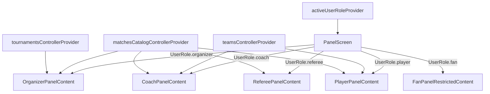

# Presentation Data Model: Panel Administrativo Dinámico por Rol (HU 12.2)

**Feature**: `017-role-dynamic-panel`
**Date**: 2026-11-06

---

## 1. Modelos de Datos de Presentación

### 1.1 `OrganizerPanelData`
Agregado de datos consumido por `OrganizerPanelContent`:

```dart
class OrganizerPanelData {
  final int activeTournamentsCount;
  final int pendingScheduleMatchesCount;
  final int unseededTournamentsCount;

  const OrganizerPanelData({
    required this.activeTournamentsCount,
    required this.pendingScheduleMatchesCount,
    required this.unseededTournamentsCount,
  });
}
```

### 1.2 `CoachPanelData`
Agregado de datos consumido por `CoachPanelContent`:

```dart
class CoachPanelData {
  final TournamentTeam? team;
  final int totalPlayers;
  final int eligiblePlayersCount;
  final int suspendedPlayersCount;
  final ChampionshipMatch? nextMatch;

  const CoachPanelData({
    this.team,
    required this.totalPlayers,
    required this.eligiblePlayersCount,
    required this.suspendedPlayersCount,
    this.nextMatch,
  });
}
```

### 1.3 `RefereePanelData`
Agregado de datos consumido por `RefereePanelContent`:

```dart
class RefereePanelData {
  final List<ChampionshipMatch> assignedMatches;

  const RefereePanelData({
    required this.assignedMatches,
  });
}
```

### 1.4 `PlayerPanelData`
Agregado de datos consumido por `PlayerPanelContent`:

```dart
class PlayerPanelData {
  final RegisteredPlayer? player;
  final TournamentTeam? team;
  final bool isEligible;
  final int goals;
  final int assists;
  final int yellowCards;
  final int redCards;
  final int matchesPlayed;
  final ChampionshipMatch? nextMatch;

  const PlayerPanelData({
    this.player,
    this.team,
    required this.isEligible,
    required this.goals,
    required this.assists,
    required this.yellowCards,
    required this.redCards,
    required this.matchesPlayed,
    this.nextMatch,
  });
}
```

---

## 2. Matriz de Autorización y Renderizado por Rol

| Rol (`UserRole`) | Título AppBar Localizado | Widget Principal | Métricas Clave | Acciones Rápidas |
| :--- | :--- | :--- | :--- | :--- |
| `organizer` | `l10n.panelTitleOrganizer` ("Panel de Organización") | `OrganizerPanelContent` | Torneos activos, partidos pendientes, torneos sin fixture | Generar Fixture, Programar Partido, Copia de Seguridad |
| `coach` | `l10n.panelTitleCoach` ("Panel Técnico") | `CoachPanelContent` | Jugadores habilitados vs suspendidos, total plantilla | Convocatoria Próximo Partido, Gestionar Plantilla |
| `referee` | `l10n.panelTitleReferee` ("Panel Arbitral") | `RefereePanelContent` | Partidos asignados (o estado vacío) | Abrir Acta Digital (por partido) |
| `player` | `l10n.panelTitlePlayer` ("Ficha del Jugador") | `PlayerPanelContent` | Insignia de elegibilidad, goles, asistencias, tarjetas | Próximo partido del club |
| `fan` | `l10n.drawerPanel` ("Panel") | `FanPanelRestrictedContent` | Mensaje informativo de restricción de acceso | Botón *"Volver a Partidos"* |

---

## 3. Flujo de Datos y Dependencias Reactivas


