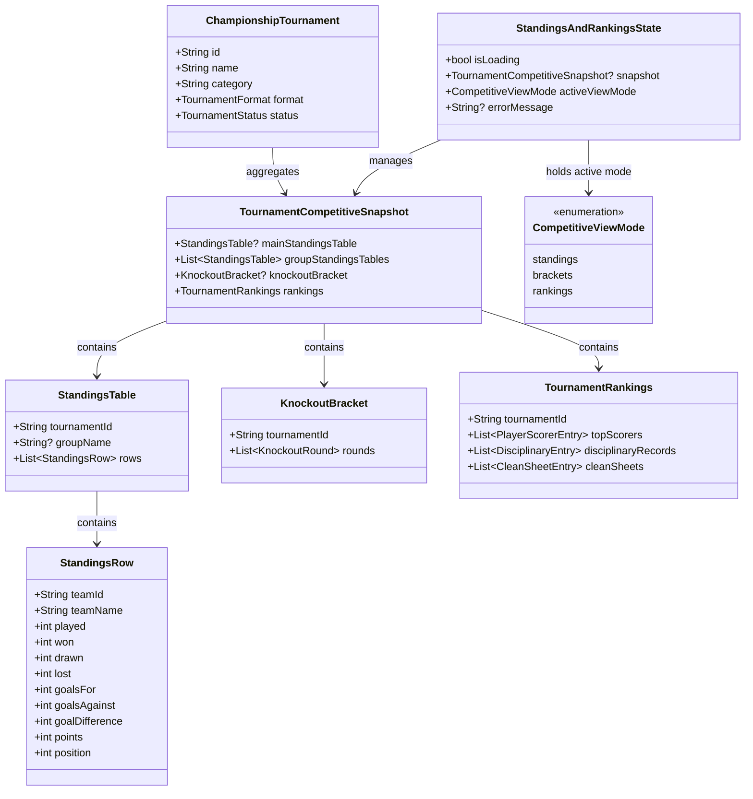

# Data Model: Pestaña de Clasificación y Resultados de Equipos en el Detalle de Competición (HU 13.2)

**Feature**: `019-competition-detail-standings`  
**Status**: Completed  
**Date**: 2026-11-06

---

## 1. Entity & Value Object Definitions

---

## 2. Competitive Subview Mapping

| `TournamentFormat` | Available Subviews (`CompetitiveViewMode`) | Default Active Subview | Content Card |
|-------------------|------------------------------------------|------------------------|--------------|
| `league` | `[standings, rankings]` | `standings` | `StandingsTableCard`, `TournamentRankingsCard` |
| `knockoutCup` | `[brackets, rankings]` | `brackets` | `KnockoutBracketCard`, `TournamentRankingsCard` |
| `mixedGroupsAndKnockout` | `[standings, brackets, rankings]` | `standings` | `StandingsTableCard` (with group tabs), `KnockoutBracketCard`, `TournamentRankingsCard` |

---

## 3. Invariants & Rules

1. **Determinism**: The position `#` and points in `StandingsRow` are computed deterministically from verified completed match reports (`DigitalMatchReport`).
2. **Tie-Breaker Ordering**: Teams tied in points are ordered by goal difference (`goalsFor - goalsAgainst`), then goals for (`goalsFor`), followed by fair play cards.
3. **Format Integrity**: A tournament of format `knockoutCup` never presents an empty `StandingsTableCard`; it directly defaults to `brackets`.
4. **Offline Consistency**: All rankings and standings tables are recomputed using locally persisted data via `LocalStorageRepository`.
