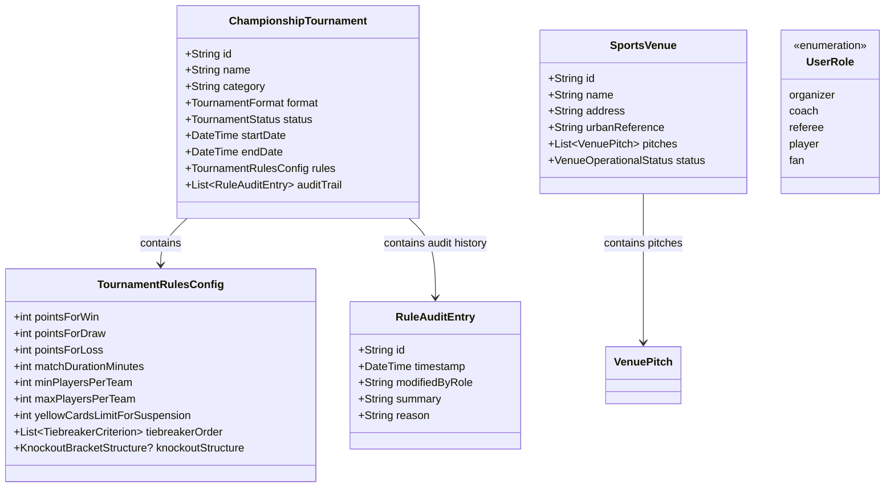
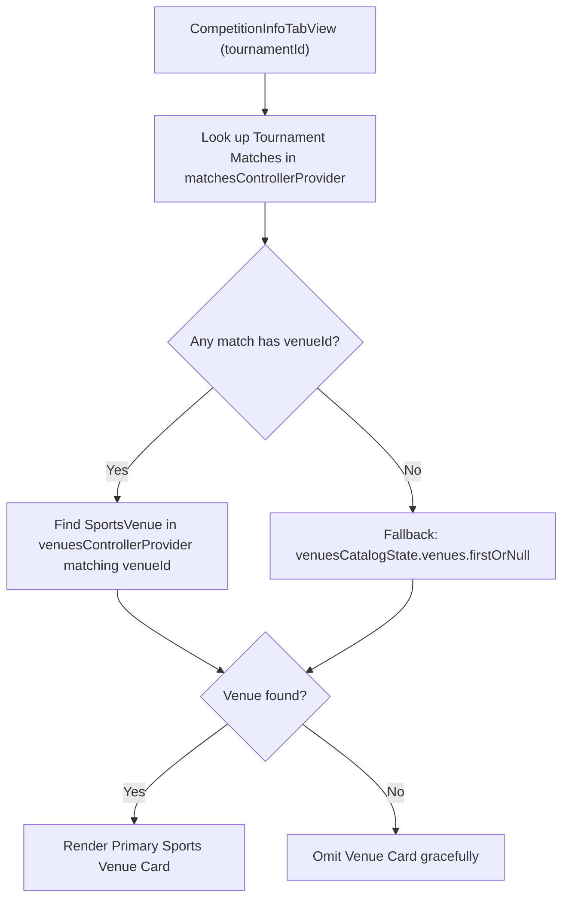

# Data Model: Pestaña de Información y Reglas Oficiales de la Competición (HU 13.3)

**Feature**: `020-competition-detail-rules`  
**Status**: Completed  
**Date**: 2026-11-06

---

## 1. Entity & Value Object Definitions

---

## 2. Invariants & Visibility Rules

| Component / Section | Invariant / Guard Condition | Target Audience / Roles | Visual Treatment |
|---------------------|-----------------------------|-------------------------|------------------|
| **Tournament Header & Status** | `tournament != null` | All roles (`organizer`, `coach`, `referee`, `player`, `fan`) | Status badge, format badge, category, dates `DD/MM/AAAA`. |
| **Scoring System** | `rules != null` | All roles | Metrics boxes: `pointsForWin`, `pointsForDraw`, `pointsForLoss`. |
| **Tiebreaker Criteria** | `format.hasStandingsTable` | All roles | Ordered list of `tiebreakerOrder` (1. Diff, 2. GF, etc.). |
| **Match Parameters** | Always present | All roles | Duration per half (`matchDurationMinutes`), format, and rounds. |
| **Squad & Discipline** | Always present | All roles | `minPlayersPerTeam`, `maxPlayersPerTeam`, `yellowCardsLimitForSuspension`. |
| **Knockout Structure** | `format == knockoutCup \|\| mixed` | All roles | Total rounds, third place match, overtime & penalties policies. |
| **Audit Trail Card** | `isOrganizer && tournament.auditTrail.isNotEmpty` | `UserRole.organizer` ONLY | Chronological list of audit changes. Completely hidden for non-organizers and when empty. |
| **Main Venue Card** | `primaryVenue != null` | All roles | Name, address, active pitches count, icon. Omitted if no venue is resolved. |
| **Management Actions** | Disabled / `null` in tab | All roles (Read-Only) | All action callbacks (`onEditPressed`, etc.) set to `null`. |

---

## 3. Venue Resolution Flow

