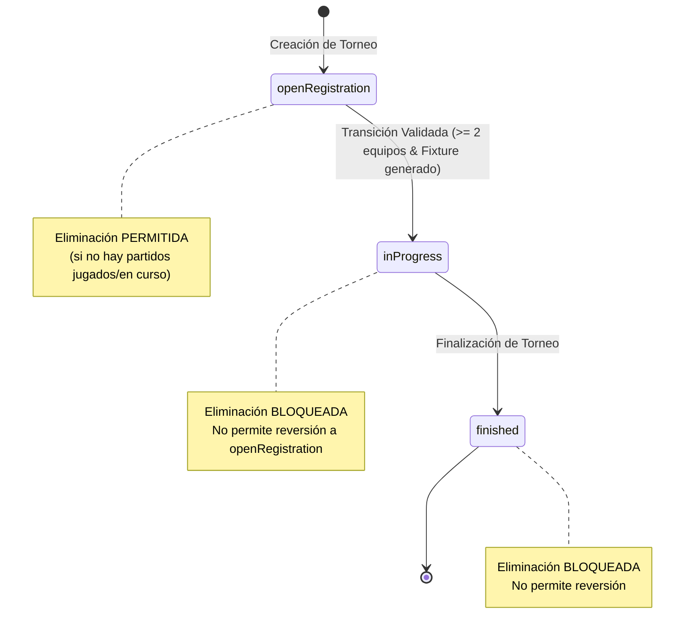

# Data Model & Domain Design: Gestión Integral (CRUD) y Ciclo de Vida de Competiciones en Panel del Organizador (HU 16.1)

**Feature**: `028-organizer-competitions-crud`
**Date**: 2026-11-10

## 1. Domain Entities & Value Objects

### 1.1 `ChampionshipTournament` (Updated)
Located in: `lib/domain/entities/championship_tournament.dart`

```dart
class ChampionshipTournament {
  final String id;
  final String name;
  final String category;
  final DateTime startDate;
  final DateTime endDate;
  final TournamentFormat format;
  final TournamentStatus status;
  final List<TournamentTeamRegistration> teams;
  final TournamentRulesConfig rules;
  final TournamentScoringSystem scoringSystem;
  final int editionNumber;
  final String? location;
  final String? logoUrl;
  final DateTime createdAt;
  final DateTime updatedAt;
  final String? organizerId; // NEW FIELD: associates tournament with organizer

  const ChampionshipTournament({
    required this.id,
    required this.name,
    required this.category,
    required this.startDate,
    required this.endDate,
    required this.format,
    required this.status,
    this.teams = const [],
    this.rules = const TournamentRulesConfig(),
    this.scoringSystem = const TournamentScoringSystem(),
    this.editionNumber = 1,
    this.location,
    this.logoUrl,
    DateTime? createdAt,
    DateTime? updatedAt,
    this.organizerId,
  }) : createdAt = createdAt ?? startDate,
       updatedAt = updatedAt ?? startDate;

  ChampionshipTournament copyWith({
    String? id,
    String? name,
    String? category,
    DateTime? startDate,
    DateTime? endDate,
    TournamentFormat? format,
    TournamentStatus? status,
    List<TournamentTeamRegistration>? teams,
    TournamentRulesConfig? rules,
    TournamentScoringSystem? scoringSystem,
    int? editionNumber,
    String? location,
    String? logoUrl,
    DateTime? createdAt,
    DateTime? updatedAt,
    String? organizerId,
  });

  Map<String, dynamic> toJson();
  factory ChampionshipTournament.fromJson(Map<String, dynamic> json);
}
```

### 1.2 `TournamentStatus` Lifecycle Transitions



---

## 2. Repository Interface Updates

### 2.1 `TournamentsRepository` (`lib/domain/repositories/tournaments_repository.dart`)

```dart
abstract interface class TournamentsRepository {
  Future<List<ChampionshipTournament>> loadTournaments();
  Future<ChampionshipTournament> saveTournament(ChampionshipTournament tournament);
  Future<void> deleteTournament(String tournamentId); // NEW METHOD
  Future<TournamentDraft?> loadDraft();
  Future<void> saveDraft(TournamentDraft draft);
  Future<void> clearDraft();
}
```

### 2.2 `LocalTournamentsRepository` Implementation (`lib/infrastructure/repositories/local_tournaments_repository.dart`)

```dart
@override
Future<void> deleteTournament(String tournamentId) async {
  final tournaments = await loadTournaments();
  final updated = tournaments.where((t) => t.id != tournamentId).toList();
  await _persistTournaments(updated);
}
```

---

## 3. Application Use Cases & Validation Services

### 3.1 `UpdateTournamentMetadataUseCase`
- **Input**:
  - `tournamentId`: `String`
  - `name`: `String` (min 3 chars, max 60 chars)
  - `category`: `String`
  - `format`: `TournamentFormat`
  - `scoringSystem`: `TournamentScoringSystem`
  - `rules`: `TournamentRulesConfig`
- **Preconditions**:
  - Tournament exists.
  - Caller is organizer and owns tournament or has authorized role.
- **Output**: Updated `ChampionshipTournament`.

### 3.2 `TransitionTournamentStatusUseCase`
- **Input**:
  - `tournamentId`: `String`
  - `targetStatus`: `TournamentStatus`
  - `enrolledTeamsCount`: `int`
  - `hasGeneratedFixture`: `bool`
- **Validation Rules**:
  1. `openRegistration` → `inProgress`:
     - Requires `enrolledTeamsCount >= 2` (or returns error).
     - Requires `hasGeneratedFixture == true` (or returns error).
  2. `inProgress` → `finished`:
     - Allowed upon organizer confirmation.
  3. Any backwards transition (`inProgress` → `openRegistration`, `finished` → any):
     - Rejected with invalid transition error.
- **Output**: Updated `ChampionshipTournament`.

### 3.3 `DeleteTournamentUseCase`
- **Input**:
  - `tournamentId`: `String`
  - `currentStatus`: `TournamentStatus`
  - `hasStartedOrCompletedMatches`: `bool`
- **Validation Rules**:
  1. If `currentStatus != TournamentStatus.openRegistration`:
     - Throw/return error: "No se puede eliminar una competición en curso o finalizada."
  2. If `hasStartedOrCompletedMatches == true`:
     - Throw/return error: "No se puede eliminar una competición con partidos disputados o actas registradas."
  3. Otherwise:
     - Invoke `tournamentsRepository.deleteTournament(tournamentId)`.
     - Cascade delete all scheduled/unplayed matches for this `tournamentId` from `TournamentMatchesRepository` to prevent orphan records.
     - If `tournamentId == selectedTournamentId`, reset selection to first available organizer tournament or `null`.
- **Output**: `void` on success.

---

## 4. State Management (Riverpod)

### 4.1 New / Updated Providers in `lib/application/providers/tournaments_providers.dart`

```dart
/// Filtered list of tournaments belonging to the currently logged in organizer.
final organizerTournamentsProvider = Provider<List<ChampionshipTournament>>((ref) {
  final tournamentsState = ref.watch(tournamentsControllerProvider);
  final authState = ref.watch(authControllerProvider);
  final currentUserId = authState.session?.user.id ?? 'org-seed-1';
  return tournamentsState.tournaments
      .where((t) => (t.organizerId ?? 'org-seed-1') == currentUserId)
      .toList();
});
```

### 4.2 Extended Methods in `TournamentsController`

```dart
Future<bool> updateTournamentMetadata({
  required String tournamentId,
  required String name,
  required String category,
  required TournamentFormat format,
  required TournamentScoringSystem scoringSystem,
  required TournamentRulesConfig rules,
});

Future<bool> transitionTournamentStatus({
  required String tournamentId,
  required TournamentStatus targetStatus,
  required int enrolledTeamsCount,
  required bool hasGeneratedFixture,
});

Future<bool> deleteTournament({
  required String tournamentId,
  required bool hasStartedOrCompletedMatches,
});
```
