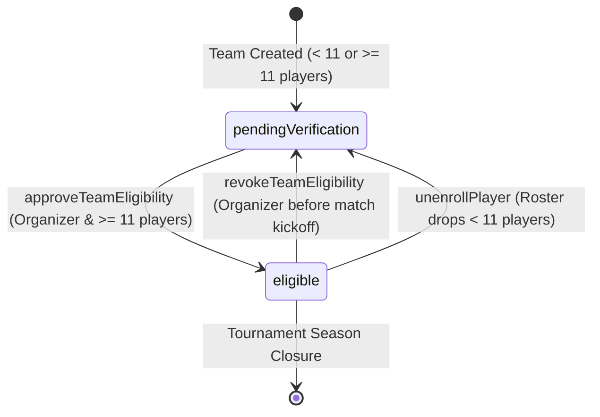

# Data Model: Team Approval & Fixture Eligibility

**Feature Branch**: `030-team-approval-fixture-eligibility` | **Date**: 2026-11-10

## 1. Entity Definitions & Lifecycle



---

## 2. Updated Domain Entities

### `TeamEligibilityStatus` (`lib/domain/entities/team_enums.dart`)

```dart
enum TeamEligibilityStatus {
  /// Roster is pending verification, incomplete (< 11 players), or reverted by the organizer.
  pendingVerification,

  /// Officially approved by the organizer with >= 11 players. Eligible for fixture generation and matches.
  eligible;

  /// Retrocompatible JSON deserialization
  static TeamEligibilityStatus fromJson(String value) {
    return switch (value) {
      'eligible' => TeamEligibilityStatus.eligible,
      'pendingVerification' || 'pendingQuota' || 'readyForApproval' || _ =>
        TeamEligibilityStatus.pendingVerification,
    };
  }
}
```

### `TournamentTeam` (`lib/domain/entities/tournament_team.dart`)

| Attribute | Type | Default | Description |
|---|---|---|---|
| `id` | `String` | required | Unique immutable identifier |
| `name` | `String` | required | Official club name |
| `shortCode` | `String` | required | 3-4 character abbreviation |
| `tournamentId` | `String` | `''` | Associated tournament identifier |
| `coachId` | `String?` | `'coach-seed-1'` | Responsible coach user identifier |
| `players` | `List<TournamentPlayer>` | `[]` | Registered roster squad |
| `eligibilityStatus`| `TeamEligibilityStatus` | `pendingVerification` | Verification and competition status |
| `crestShape` | `TeamCrestShape` | `shield` | Visual crest geometry |
| `primaryColorHex` | `String` | `'#00E5FF'` | Primary club kit color |
| `secondaryColorHex`| `String` | `'#0A0E17'` | Secondary kit accent color |
| `isEligible` | `bool` (getter) | `eligibilityStatus == TeamEligibilityStatus.eligible` | Computed fixture/match readiness |

---

## 3. Invariants & Business Rules

1. **Cuota Reglamentaria Innegociable**:
   - `team.players.length >= 11` es precondición obligatoria para que `approveTeamEligibility` tenga éxito.
   - Si `team.players.length < 11`, la transición es rechazada con `TeamEligibilityValidationFailure`.
2. **Auto-Democión Reactiva**:
   - Si `team.eligibilityStatus == eligible` y una operación de remoción deja `team.players.length < 11`, el equipo transiciona automáticamente a `pendingVerification`.
3. **Condición de Fixture**:
   - El fixture solo compila equipos con `tournamentId == tournament.id && isEligible == true`.
   - Se requiere `count(eligibleTeams) >= 2`. De lo contrario, se bloquea la generación con `FixtureScheduleValidationFailure`.
