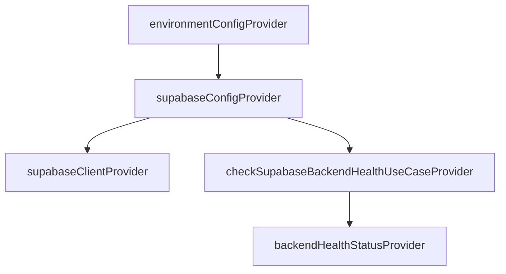

# Data Model: Conexión e Integración del Backend Supabase DEV (HU 17.1)

**Feature**: `031-supabase-dev-backend`  
**Date**: 2026-11-10  

---

## 1. Entidades y Value Objects

### `SupabaseConfig` (Value Object Inmutable)
Encapsula la configuración de conexión hacia el backend de Supabase.

```dart
class SupabaseConfig {
  final String url;
  final String anonKey;
  final bool isConfigured;

  const SupabaseConfig({
    required this.url,
    required this.anonKey,
  }) : isConfigured = url.isNotEmpty && anonKey.isNotEmpty;

  const SupabaseConfig.empty()
      : url = '',
        anonKey = '',
        isConfigured = false;

  Map<String, dynamic> toSafeDiagnosticMap() {
    return {
      'url': url,
      'anonKey': anonKey.isEmpty ? '[EMPTY]' : '[REDACTED]',
      'isConfigured': isConfigured,
    };
  }
}
```

### `BackendHealthStatus` (Domain Enum / State)
Representa el resultado del handshake o comprobación de salud contra el API Gateway de Supabase en Oracle Cloud.

```dart
enum BackendHealthStatus {
  /// No se han configurado credenciales (modo puramente local).
  unconfigured,

  /// Comprobación de salud en curso.
  checking,

  /// El servidor respondió exitosamente (HTTP 200 OK en /rest/v1/).
  healthy,

  /// El servidor no responde, tiempo de espera agotado o error de red.
  unreachable,
}
```

### `BackendHealthCheckResult` (Value Object)
Resultado detallado de la ejecución del health check.

```dart
class BackendHealthCheckResult {
  final BackendHealthStatus status;
  final int? httpStatusCode;
  final Duration latency;
  final String? errorMessage;
  final DateTime timestamp;

  const BackendHealthCheckResult({
    required this.status,
    this.httpStatusCode,
    required this.latency,
    this.errorMessage,
    required this.timestamp,
  });

  bool get isHealthy => status == BackendHealthStatus.healthy;
}
```

---

## 2. Extensión de `EnvironmentConfig`

Se incorpora el atributo `supabase` a la clase existente `EnvironmentConfig`:

```dart
class EnvironmentConfig {
  final AppEnvironment environment;
  final String appName;
  final String localStoragePrefix;
  final String apiBaseUrl;
  final String apiAnonKey;
  final bool showEnvironmentBanner;
  final SupabaseConfig supabase; // <-- NUEVO
  ...
}
```

- En `EnvironmentConfig.development`:
  - `url`: `const String.fromEnvironment('SUPABASE_URL', defaultValue: 'https://supabase.artbusinesstechnology.com')`
  - `anonKey`: `const String.fromEnvironment('SUPABASE_ANON_KEY', defaultValue: '')`
- En `EnvironmentConfig.production`:
  - Requiere variables de producción aisladas sin tomar defaults de desarrollo.

---

## 3. Estado en Capa de Aplicación (Riverpod Providers)



- **`supabaseConfigProvider`** (`Provider<SupabaseConfig>`): Expone la configuración de Supabase desde `EnvironmentConfig`.
- **`supabaseClientProvider`** (`Provider<SupabaseClient?>`): Expone la instancia activa de `Supabase.instance.client` si `isConfigured` es verdadero y la inicialización fue exitosa, o `null` si opera en modo local.
- **`backendHealthStatusProvider`** (`StateNotifierProvider<BackendHealthNotifier, BackendHealthCheckResult>`): Gestiona el ciclo de vida del health check en segundo plano o bajo demanda.
