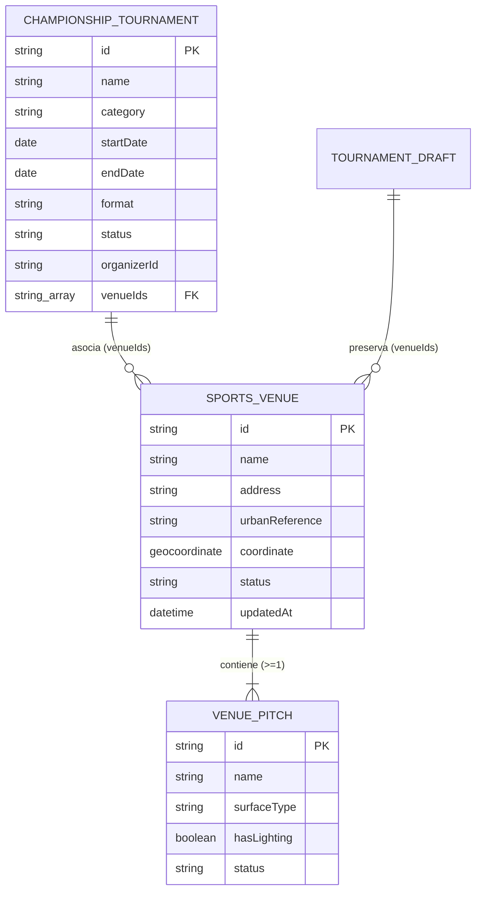

# Data Model: Creación y Vinculación de Sedes en el Formulario de Nueva Competición (HU 18.1)

**Feature**: `032-competition-inline-venues`  
**Date**: 2026-11-11  

---

## 1. Entidades y Modelos Modificados

### `ChampionshipTournament` (Aggregate Root)
Se extiende la entidad para incluir la lista de identificadores de sedes deportivas oficiales asignadas al campeonato.

```dart
class ChampionshipTournament {
  final String id;
  final String name;
  final String category;
  final DateTime startDate;
  final DateTime endDate;
  final TournamentFormat format;
  final TournamentStatus status;
  final TournamentRulesConfig rules;
  final List<RuleAuditEntry> auditTrail;
  final DateTime updatedAt;
  final String? organizerId;
  final List<String> venueIds; // <-- NUEVO

  const ChampionshipTournament({
    required this.id,
    required this.name,
    required this.category,
    required this.startDate,
    required this.endDate,
    required this.format,
    this.status = TournamentStatus.openRegistration,
    this.rules = const TournamentRulesConfig(),
    this.auditTrail = const <RuleAuditEntry>[],
    required this.updatedAt,
    this.organizerId = 'org-seed-1',
    this.venueIds = const <String>[], // Valor por defecto retrocompatible
  });
}
```

#### Serialización JSON
- Clave: `'venueIds'` (`List<dynamic>` mapeada a `List<String>`).
- Manejo defensivo en `fromJson`: `(json['venueIds'] as List<dynamic>?)?.map((e) => e.toString()).toList() ?? const <String>[]`.

---

### `TournamentDraft` (Value Object de Borrador Móvil)
Se extiende para preservar las sedes seleccionadas en memoria local si la app pasa a segundo plano o el usuario interrumpe el flujo.

```dart
class TournamentDraft {
  final String name;
  final String category;
  final DateTime startDate;
  final DateTime endDate;
  final TournamentFormat format;
  final TournamentRulesConfig rules;
  final DateTime savedAt;
  final List<String> venueIds; // <-- NUEVO

  const TournamentDraft({
    required this.name,
    required this.category,
    required this.startDate,
    required this.endDate,
    this.format = TournamentFormat.league,
    this.rules = const TournamentRulesConfig(),
    required this.savedAt,
    this.venueIds = const <String>[],
  });
}
```

---

### `SportsVenue` (Entidad de Sede Deportiva)
Representa el complejo deportivo creado y registrado en el catálogo general.

```dart
class SportsVenue {
  final String id;
  final String name;
  final String address;
  final String urbanReference;
  final GeoCoordinate coordinate;
  final List<VenuePitch> pitches;
  final VenueOperationalStatus status;
  final DateTime updatedAt;
}
```

- **Invariantes**:
  - `name.trim().length >= 3`
  - `address.trim().length >= 5`
  - `pitches.length >= 1`
  - `pitches.any((p) => p.status == VenueOperationalStatus.active) == true`
  - Unicidad: No puede existir otra sede con `name.trim().toLowerCase() == this.name.trim().toLowerCase()` en el repositorio.

---

### `VenuePitch` (Entidad de Cancha Interna)
Representa cada una de las canchas generadas dentro de la sede.

```dart
class VenuePitch {
  final String id;
  final String name;
  final PitchSurfaceType surfaceType;
  final bool hasLighting;
  final VenueOperationalStatus status;
}
```

- **Generación en Flujo Rápido**:
  - `name`: `'Cancha ${index + 1}'`
  - `surfaceType`: `PitchSurfaceType.syntheticTurf`
  - `hasLighting`: `true`
  - `status`: `VenueOperationalStatus.active`

---

## 2. Diagrama Entidad-Relación



---

## 3. Validaciones de Dominio y Errores

| Restricción | Validación | Código de Error / Fallo | Mensaje de Usuario |
|---|---|---|---|
| Nombre de Sede | Longitud $\ge 3$ caracteres no vacíos | `InvalidVenueDataFailure` | "El nombre de la sede debe tener al menos 3 caracteres" |
| Dirección de Sede | Longitud $\ge 5$ caracteres no vacíos | `InvalidVenueDataFailure` | "La dirección debe tener al menos 5 caracteres" |
| Número de Canchas | Entero $\ge 1$ | `InvalidVenueDataFailure` | "Debes ingresar al menos 1 cancha" |
| Unicidad de Nombre | Comparación insensible a mayúsculas contra sedes existentes | `InvalidVenueDataFailure` | "Ya existe una sede con este nombre. Selecciónala de la lista o elige un nombre diferente" |
