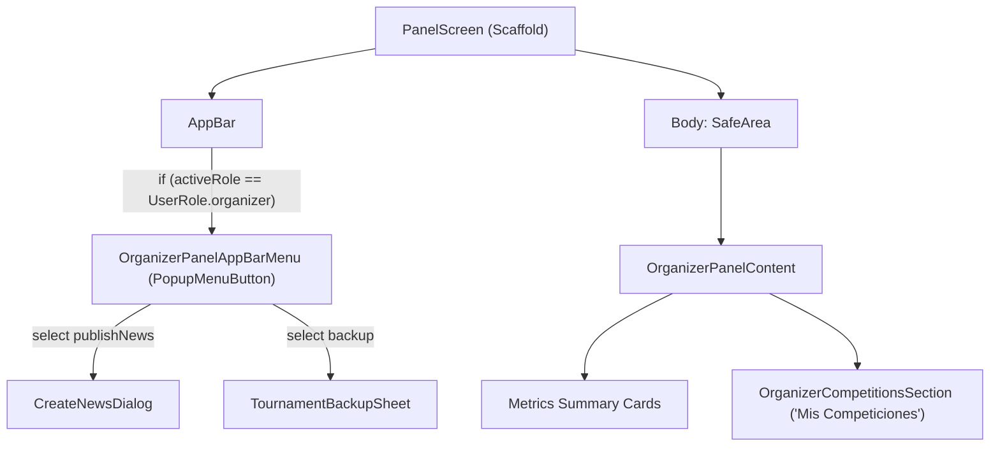

# Data Model & Presentation Architecture: Reorganización del Panel de Organización (HU 18.2)

**Feature**: `033-organizer-panel-menu`  
**Date**: 2026-11-11  

---

## 1. Modelos de Presentación y Enumeraciones

### `OrganizerMenuAction`
Representa las acciones administrativas globales disponibles en el menú contextual de la barra superior del organizador.

```dart
/// Identifiers for global administrative actions available in the organizer panel AppBar.
enum OrganizerMenuAction {
  /// Opens the form to publish official news announcements.
  publishNews,

  /// Opens the backup export/import and historical season closure sheet.
  backup,
}
```

---

## 2. Jerarquía de Componentes y Flujo de Datos



---

## 3. Comparativa de Layout del Panel del Organizador

| Sección | Estado Anterior (HU 18.1) | Nuevo Estado (HU 18.2) |
|---|---|---|
| **Barra Superior (AppBar)** | Solo título de rol (`Panel Organizador`) y botón atrás | Título de rol + `PopupMenuButton` con "Publicar Noticia" y "Copia de Seguridad" |
| **Cabecera del Cuerpo** | Resumen de Métricas (3 tarjetas) | Resumen de Métricas (3 tarjetas) — *Sin cambios* |
| **Zona Media del Cuerpo** | Título y tarjeta de "Acciones Rápidas" con 4 botones | **ELIMINADO DEFINITIVAMENTE** |
| **Zona Inferior del Cuerpo** | Sección de "Mis Competiciones" (después de scroll) | Sección de "Mis Competiciones" (inmediatamente visible tras las métricas) |
| **Generar Fixture** | Botón redundante en Acciones Rápidas del panel | Centralizado en el FAB Menu del detalle del torneo |
| **Programar Partido** | Botón redundante en Acciones Rápidas del panel | Centralizado en la vista de jornada y fixture de la competición |
