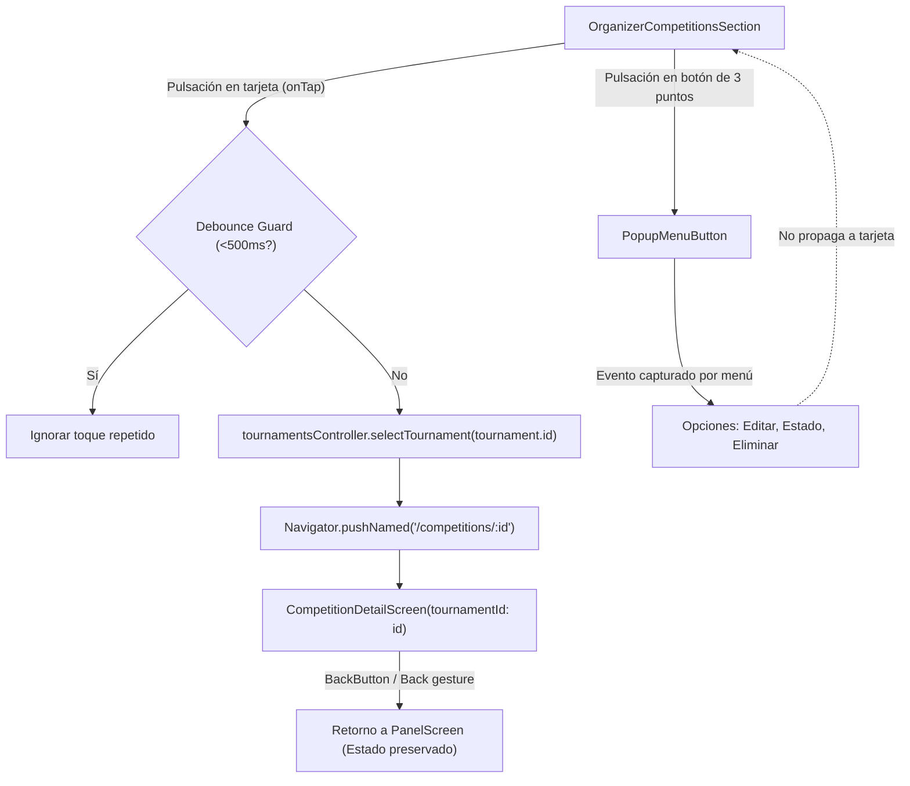

# Data Model & State Architecture: Navegación a Detalles de la Competición (HU 18.3)

**Feature**: `034-organizer-competition-navigation`  
**Date**: 2026-11-11  

---

## 1. Entidades Involucradas

### `ChampionshipTournament` (Dominio)
Entidad inmutable que representa la competición deportiva gestionada por el organizador.

```dart
class ChampionshipTournament {
  final String id;
  final String name;
  final String category;
  final TournamentFormat format;
  final TournamentStatus status;
  final DateTime startDate;
  final DateTime endDate;
  final String? logoUrl;
  final String? bannerUrl;
  final DateTime updatedAt;
  final List<String> venueIds;
}
```

---

## 2. Flujo de Estado y Navegación



---

## 3. Identificadores y Claves de Widgets (`Key`)

| Elemento | Key Pattern | Propósito |
|---|---|---|
| Tarjeta de competición | `organizer_competition_card_${tournament.id}` | Superficie táctil con `onTap` |
| Menú contextual (3 puntos) | `organizer_competition_menu_button_${tournament.id}` | Botón de opciones secundarias aislado |
| Opción Editar | `organizer_competition_menu_edit_${tournament.id}` | Menú emergente |
| Opción Estado | `organizer_competition_menu_status_${tournament.id}` | Menú emergente |
| Opción Eliminar | `organizer_competition_menu_delete_${tournament.id}` | Menú emergente |
