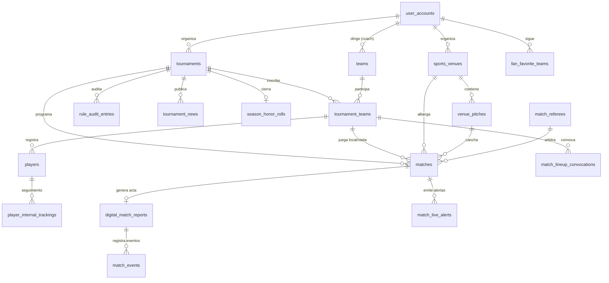

# Data Model: Esquema Relacional `vifutboldev` (HU 17.2)

**Feature**: `036-supabase-vifutboldev-schema`  
**Date**: 2026-11-11  

---

## Convenciones Globales

- **Namespace exclusivo**: Todas las tablas, tipos, funciones auxiliares y políticas residen en `vifutboldev.*`. Cero objetos de negocio en `public`.
- **Llave primaria**: `id uuid PRIMARY KEY DEFAULT gen_random_uuid()` en todas las tablas.
- **Auditoría temporal**: `created_at timestamptz NOT NULL DEFAULT now()` y `updated_at timestamptz NOT NULL DEFAULT now()` mantenido vía trigger `BEFORE UPDATE FOR EACH ROW EXECUTE FUNCTION vifutboldev.set_updated_at()`.
- **Integridad de índices**: B-Tree obligatorio en toda columna FK, columna usada en RLS y columna de filtrado operativo frecuente.

---

## Diagrama Entidad-Relación (Resumen)

---

## Catálogo de Tablas (18 Entidades)

### Bloque A: Identidad, Roles y Preferencias

1. **`vifutboldev.user_accounts`** (`UserAccount`)
   - Columnas: `id`, `auth_user_id uuid UNIQUE REFERENCES auth.users(id) ON DELETE SET NULL`, `full_name text NOT NULL`, `email text NOT NULL UNIQUE`, `active_role text NOT NULL CHECK (active_role IN ('organizer','coach','referee','player','fan'))`, `authorized_roles text[] NOT NULL DEFAULT ARRAY['fan']::text[]`, `is_guest_fan boolean NOT NULL DEFAULT false`, `onboarding_completed boolean NOT NULL DEFAULT false`, `created_at`, `updated_at`.
   - Índices: `idx_user_accounts_auth_user_id (auth_user_id)`, `idx_user_accounts_active_role (active_role)`.

2. **`vifutboldev.fan_favorite_teams`** (`FanFavoriteTeam`)
   - Columnas: `id`, `user_id uuid NOT NULL REFERENCES vifutboldev.user_accounts(id) ON DELETE CASCADE`, `tournament_id uuid NOT NULL REFERENCES vifutboldev.tournaments(id) ON DELETE CASCADE`, `team_id uuid NOT NULL REFERENCES vifutboldev.teams(id) ON DELETE CASCADE`, `team_name text NOT NULL`, `notifications_enabled boolean NOT NULL DEFAULT true`, `created_at`, `updated_at`.
   - Restricciones: `UNIQUE (user_id, tournament_id, team_id)`.
   - Índices: FK indexes en `user_id`, `tournament_id`, `team_id`.

### Bloque B: Infraestructura Deportiva (Sedes y Canchas)

3. **`vifutboldev.sports_venues`** (`SportsVenue`)
   - Columnas: `id`, `organizer_id uuid REFERENCES vifutboldev.user_accounts(id) ON DELETE SET NULL`, `name text NOT NULL CHECK (char_length(trim(name)) >= 3)`, `address text NOT NULL CHECK (char_length(trim(address)) >= 5)`, `urban_reference text NOT NULL DEFAULT ''`, `latitude double precision NOT NULL`, `longitude double precision NOT NULL`, `status text NOT NULL DEFAULT 'active' CHECK (status IN ('active','maintenance','inactive'))`, `created_at`, `updated_at`.
   - Índices: `idx_sports_venues_organizer_id`, `idx_sports_venues_status`.

4. **`vifutboldev.venue_pitches`** (`VenuePitch`)
   - Columnas: `id`, `venue_id uuid NOT NULL REFERENCES vifutboldev.sports_venues(id) ON DELETE CASCADE`, `name text NOT NULL CHECK (char_length(trim(name)) >= 2)`, `surface_type text NOT NULL CHECK (surface_type IN ('naturalGrass','syntheticGrass','hybrid','indoorCourt','dirt'))`, `format text NOT NULL CHECK (format IN ('football11','football9','football7','football5'))`, `capacity integer NOT NULL DEFAULT 0 CHECK (capacity >= 0)`, `has_lighting boolean NOT NULL DEFAULT false`, `status text NOT NULL DEFAULT 'active' CHECK (status IN ('active','maintenance','inactive'))`, `created_at`, `updated_at`.
   - Índices: `idx_venue_pitches_venue_id`, `idx_venue_pitches_status`.

### Bloque C: Competiciones, Reglas y Gobernanza

5. **`vifutboldev.tournaments`** (`ChampionshipTournament`)
   - Columnas: `id`, `organizer_id uuid REFERENCES vifutboldev.user_accounts(id) ON DELETE SET NULL`, `name text NOT NULL CHECK (char_length(trim(name)) >= 3)`, `category text NOT NULL`, `start_date timestamptz NOT NULL`, `end_date timestamptz NOT NULL`, `format text NOT NULL CHECK (format IN ('league','knockoutCup','mixedGroupsAndKnockout'))`, `status text NOT NULL DEFAULT 'openRegistration' CHECK (status IN ('openRegistration','inProgress','finished'))`, `rules_config jsonb NOT NULL DEFAULT '{}'::jsonb`, `venue_ids uuid[] NOT NULL DEFAULT ARRAY[]::uuid[]`, `created_at`, `updated_at`.
   - Índices: `idx_tournaments_organizer_id`, `idx_tournaments_status`, `idx_tournaments_start_date`.

6. **`vifutboldev.rule_audit_entries`** (`RuleAuditEntry`)
   - Columnas: `id`, `tournament_id uuid NOT NULL REFERENCES vifutboldev.tournaments(id) ON DELETE CASCADE`, `recorded_at timestamptz NOT NULL DEFAULT now()`, `summary text NOT NULL`, `reason text NOT NULL`, `recalculation_confirmed boolean NOT NULL DEFAULT true`, `created_at`, `updated_at`.
   - Índices: `idx_rule_audit_entries_tournament_id`, `idx_rule_audit_entries_recorded_at`.

7. **`vifutboldev.season_honor_rolls`** (`SeasonHonorRoll`)
   - Columnas: `id`, `tournament_id uuid NOT NULL UNIQUE REFERENCES vifutboldev.tournaments(id) ON DELETE CASCADE`, `tournament_name text NOT NULL`, `closed_at timestamptz NOT NULL`, `champion_team_id uuid NOT NULL REFERENCES vifutboldev.tournament_teams(id)`, `champion_team_name text NOT NULL`, `champion_short_code text NOT NULL`, `runner_up_team_id uuid NOT NULL REFERENCES vifutboldev.tournament_teams(id)`, `runner_up_team_name text NOT NULL`, `runner_up_short_code text NOT NULL`, `top_scorer_player_id uuid REFERENCES vifutboldev.players(id) ON DELETE SET NULL`, `top_scorer_player_name text`, `top_scorer_team_name text`, `top_scorer_goals integer NOT NULL DEFAULT 0 CHECK (top_scorer_goals >= 0)`, `best_defense_team_id uuid NOT NULL REFERENCES vifutboldev.tournament_teams(id)`, `best_defense_team_name text NOT NULL`, `best_defense_short_code text NOT NULL`, `best_defense_goals_against integer NOT NULL CHECK (best_defense_goals_against >= 0)`, `created_at`, `updated_at`.
   - Restricciones: `CHECK (champion_team_id <> runner_up_team_id)`.
   - Índices: FK indexes en `champion_team_id`, `runner_up_team_id`, `top_scorer_player_id`, `best_defense_team_id`.

8. **`vifutboldev.tournament_news`** (`TournamentNewsItem`)
   - Columnas: `id`, `tournament_id uuid NOT NULL REFERENCES vifutboldev.tournaments(id) ON DELETE CASCADE`, `title text NOT NULL CHECK (char_length(trim(title)) BETWEEN 3 AND 120)`, `body text NOT NULL CHECK (char_length(trim(body)) BETWEEN 5 AND 3000)`, `category text NOT NULL CHECK (category IN ('generalAnnouncement','disciplinaryBulletin','reschedulingNotice'))`, `published_at timestamptz NOT NULL DEFAULT now()`, `author_user_id uuid REFERENCES vifutboldev.user_accounts(id) ON DELETE SET NULL`, `author_name text NOT NULL`, `is_pinned boolean NOT NULL DEFAULT false`, `created_at`, `updated_at`.
   - Índices: `idx_tournament_news_tournament_id`, `idx_tournament_news_author_user_id`, `idx_tournament_news_published_at`.

### Bloque D: Equipos, Inscripciones y Jugadores

9. **`vifutboldev.teams`** (`Team` maestro)
   - Columnas: `id`, `coach_id uuid REFERENCES vifutboldev.user_accounts(id) ON DELETE SET NULL`, `name text NOT NULL CHECK (char_length(trim(name)) >= 3)`, `normalized_name text NOT NULL UNIQUE`, `short_code text NOT NULL CHECK (char_length(trim(short_code)) BETWEEN 2 AND 4)`, `crest_shape text NOT NULL DEFAULT 'shield' CHECK (crest_shape IN ('shield','circle','diamond','hexagon'))`, `primary_color_hex integer NOT NULL DEFAULT 4278249078`, `secondary_color_hex integer NOT NULL DEFAULT 4278849047`, `category text`, `created_at`, `updated_at`.
   - Índices: `idx_teams_coach_id`, `idx_teams_normalized_name`.

10. **`vifutboldev.tournament_teams`** (Inscripción por torneo - mapea `TournamentTeam`)
    - Columnas: `id`, `tournament_id uuid NOT NULL REFERENCES vifutboldev.tournaments(id) ON DELETE CASCADE`, `team_id uuid NOT NULL REFERENCES vifutboldev.teams(id) ON DELETE CASCADE`, `group_name text`, `eligibility_status text NOT NULL DEFAULT 'pendingVerification' CHECK (eligibility_status IN ('pendingVerification','eligible'))`, `created_at`, `updated_at`.
    - Restricciones: `UNIQUE (tournament_id, team_id)`.
    - Índices: `idx_tournament_teams_tournament_id`, `idx_tournament_teams_team_id`, `idx_tournament_teams_eligibility_status`.

11. **`vifutboldev.players`** (`RegisteredPlayer`)
    - Columnas: `id`, `tournament_team_id uuid NOT NULL REFERENCES vifutboldev.tournament_teams(id) ON DELETE CASCADE`, `tournament_id uuid NOT NULL REFERENCES vifutboldev.tournaments(id) ON DELETE CASCADE`, `user_account_id uuid REFERENCES vifutboldev.user_accounts(id) ON DELETE SET NULL`, `full_name text NOT NULL CHECK (char_length(trim(full_name)) >= 3)`, `document_id text NOT NULL CHECK (char_length(trim(document_id)) >= 5)`, `normalized_document_id text NOT NULL`, `shirt_number integer NOT NULL CHECK (shirt_number BETWEEN 1 AND 99)`, `position text NOT NULL CHECK (position IN ('goalkeeper','defender','midfielder','forward'))`, `is_eligible boolean NOT NULL DEFAULT false`, `created_at`, `updated_at`.
    - Restricciones: `UNIQUE (tournament_team_id, shirt_number)`, `UNIQUE (tournament_id, normalized_document_id)`.
    - Índices: `idx_players_tournament_team_id`, `idx_players_tournament_id`, `idx_players_user_account_id`.

12. **`vifutboldev.player_internal_trackings`** (`PlayerInternalTracking`)
    - Columnas: `id`, `player_id uuid NOT NULL REFERENCES vifutboldev.players(id) ON DELETE CASCADE`, `tournament_team_id uuid NOT NULL REFERENCES vifutboldev.tournament_teams(id) ON DELETE CASCADE`, `tournament_id uuid NOT NULL REFERENCES vifutboldev.tournaments(id) ON DELETE CASCADE`, `coach_id uuid REFERENCES vifutboldev.user_accounts(id) ON DELETE SET NULL`, `matches_played integer NOT NULL DEFAULT 0 CHECK (matches_played >= 0)`, `goals integer NOT NULL DEFAULT 0 CHECK (goals >= 0)`, `assists integer NOT NULL DEFAULT 0 CHECK (assists >= 0)`, `yellow_cards integer NOT NULL DEFAULT 0 CHECK (yellow_cards >= 0)`, `red_cards integer NOT NULL DEFAULT 0 CHECK (red_cards >= 0)`, `pending_suspension_matches integer NOT NULL DEFAULT 0 CHECK (pending_suspension_matches >= 0)`, `created_at`, `updated_at`.
    - Restricciones: `UNIQUE (player_id, tournament_team_id)`.
    - Índices: FK indexes en `player_id`, `tournament_team_id`, `tournament_id`, `coach_id`.

### Bloque E: Partidos, Arbitraje, Actas y Tiempo Real

13. **`vifutboldev.match_referees`** (`MatchReferee`)
    - Columnas: `id`, `user_account_id uuid REFERENCES vifutboldev.user_accounts(id) ON DELETE SET NULL`, `full_name text NOT NULL CHECK (char_length(trim(full_name)) >= 3)`, `certification_level text NOT NULL`, `is_active boolean NOT NULL DEFAULT true`, `created_at`, `updated_at`.
    - Índices: `idx_match_referees_user_account_id`, `idx_match_referees_is_active`.

14. **`vifutboldev.matches`** (`ChampionshipMatch`)
    - Columnas: `id`, `tournament_id uuid NOT NULL REFERENCES vifutboldev.tournaments(id) ON DELETE CASCADE`, `round_number integer NOT NULL CHECK (round_number >= 1)`, `round_name text NOT NULL`, `home_tournament_team_id uuid NOT NULL REFERENCES vifutboldev.tournament_teams(id)`, `away_tournament_team_id uuid NOT NULL REFERENCES vifutboldev.tournament_teams(id)`, `scheduled_at timestamptz`, `scheduled_end_at timestamptz`, `venue_id uuid REFERENCES vifutboldev.sports_venues(id) ON DELETE SET NULL`, `pitch_id uuid REFERENCES vifutboldev.venue_pitches(id) ON DELETE SET NULL`, `pitch_name text`, `referee_id uuid REFERENCES vifutboldev.match_referees(id) ON DELETE SET NULL`, `referee_name text`, `status text NOT NULL DEFAULT 'pendingSchedule' CHECK (status IN ('pendingSchedule','scheduled','inProgress','completed','postponed','cancelled'))`, `home_score integer CHECK (home_score IS NULL OR home_score >= 0)`, `away_score integer CHECK (away_score IS NULL OR away_score >= 0)`, `home_penalty_score integer CHECK (home_penalty_score IS NULL OR home_penalty_score >= 0)`, `away_penalty_score integer CHECK (away_penalty_score IS NULL OR away_penalty_score >= 0)`, `group_name text`, `created_at`, `updated_at`.
    - Restricciones: `CHECK (home_tournament_team_id <> away_tournament_team_id)`.
    - Índices: `idx_matches_tournament_id`, `idx_matches_home_team_id`, `idx_matches_away_team_id`, `idx_matches_venue_id`, `idx_matches_pitch_id`, `idx_matches_referee_id`, `idx_matches_scheduled_at`, `idx_matches_status`.

15. **`vifutboldev.match_lineup_convocations`** (`MatchLineupConvocation`)
    - Columnas: `id`, `tournament_id uuid NOT NULL REFERENCES vifutboldev.tournaments(id) ON DELETE CASCADE`, `tournament_team_id uuid NOT NULL REFERENCES vifutboldev.tournament_teams(id) ON DELETE CASCADE`, `match_id uuid REFERENCES vifutboldev.matches(id) ON DELETE SET NULL`, `match_label text NOT NULL DEFAULT 'Próximo Partido Oficial'`, `starter_player_ids uuid[] NOT NULL DEFAULT ARRAY[]::uuid[]`, `substitute_player_ids uuid[] NOT NULL DEFAULT ARRAY[]::uuid[]`, `captain_player_id uuid REFERENCES vifutboldev.players(id) ON DELETE SET NULL`, `status text NOT NULL DEFAULT 'draft' CHECK (status IN ('draft','confirmed'))`, `confirmed_starter_player_ids uuid[] NOT NULL DEFAULT ARRAY[]::uuid[]`, `confirmed_substitute_player_ids uuid[] NOT NULL DEFAULT ARRAY[]::uuid[]`, `confirmed_captain_player_id uuid REFERENCES vifutboldev.players(id) ON DELETE SET NULL`, `confirmed_at timestamptz`, `created_at`, `updated_at`.
    - Índices: FK indexes en `tournament_id`, `tournament_team_id`, `match_id`, `captain_player_id`, `confirmed_captain_player_id`.

16. **`vifutboldev.digital_match_reports`** (`DigitalMatchReport`)
    - Columnas: `id`, `match_id uuid NOT NULL UNIQUE REFERENCES vifutboldev.matches(id) ON DELETE CASCADE`, `tournament_id uuid NOT NULL REFERENCES vifutboldev.tournaments(id) ON DELETE CASCADE`, `home_tournament_team_id uuid NOT NULL REFERENCES vifutboldev.tournament_teams(id)`, `away_tournament_team_id uuid NOT NULL REFERENCES vifutboldev.tournament_teams(id)`, `home_score integer NOT NULL DEFAULT 0 CHECK (home_score >= 0)`, `away_score integer NOT NULL DEFAULT 0 CHECK (away_score >= 0)`, `home_penalty_score integer CHECK (home_penalty_score IS NULL OR home_penalty_score >= 0)`, `away_penalty_score integer CHECK (away_penalty_score IS NULL OR away_penalty_score >= 0)`, `current_period text NOT NULL DEFAULT 'notStarted' CHECK (current_period IN ('notStarted','firstHalf','halftime','secondHalf','extraTime','penalties','closed'))`, `period_started_at timestamptz`, `elapsed_seconds_before_current_period integer NOT NULL DEFAULT 0 CHECK (elapsed_seconds_before_current_period >= 0)`, `closed_at timestamptz`, `closed_by_user_id uuid REFERENCES vifutboldev.user_accounts(id) ON DELETE SET NULL`, `observations text`, `created_at`, `updated_at`.
    - Restricciones: `CHECK (home_tournament_team_id <> away_tournament_team_id)`.
    - Índices: FK indexes en `tournament_id`, `home_tournament_team_id`, `away_tournament_team_id`, `closed_by_user_id`.

17. **`vifutboldev.match_events`** (`MatchEvent`)
    - Columnas: `id`, `report_id uuid NOT NULL REFERENCES vifutboldev.digital_match_reports(id) ON DELETE CASCADE`, `match_id uuid NOT NULL REFERENCES vifutboldev.matches(id) ON DELETE CASCADE`, `event_type text NOT NULL CHECK (event_type IN ('goal','assist','yellowCard','redCard','substitution'))`, `minute integer NOT NULL CHECK (minute BETWEEN 1 AND 130)`, `tournament_team_id uuid NOT NULL REFERENCES vifutboldev.tournament_teams(id)`, `primary_player_id uuid REFERENCES vifutboldev.players(id) ON DELETE SET NULL`, `primary_player_name text`, `primary_player_shirt_number integer`, `secondary_player_id uuid REFERENCES vifutboldev.players(id) ON DELETE SET NULL`, `secondary_player_name text`, `secondary_player_shirt_number integer`, `linked_parent_event_id uuid REFERENCES vifutboldev.match_events(id) ON DELETE SET NULL`, `description text`, `is_synced boolean NOT NULL DEFAULT true`, `created_at`, `updated_at`.
    - Índices: FK indexes en `report_id`, `match_id`, `tournament_team_id`, `primary_player_id`, `secondary_player_id`, `linked_parent_event_id`.

18. **`vifutboldev.match_live_alerts`** (`MatchLiveAlert`)
    - Columnas: `id`, `match_id uuid NOT NULL REFERENCES vifutboldev.matches(id) ON DELETE CASCADE`, `tournament_id uuid NOT NULL REFERENCES vifutboldev.tournaments(id) ON DELETE CASCADE`, `alert_type text NOT NULL CHECK (alert_type IN ('kickoff','goal','fullTime','rescheduling'))`, `title text NOT NULL`, `message text NOT NULL`, `alert_timestamp timestamptz NOT NULL DEFAULT now()`, `is_read boolean NOT NULL DEFAULT false`, `created_at`, `updated_at`.
    - Índices: FK indexes en `match_id`, `tournament_id`, `idx_match_live_alerts_timestamp`.
